<!-- victorious-fleet-readme-refresh:start -->
<p align="center">
  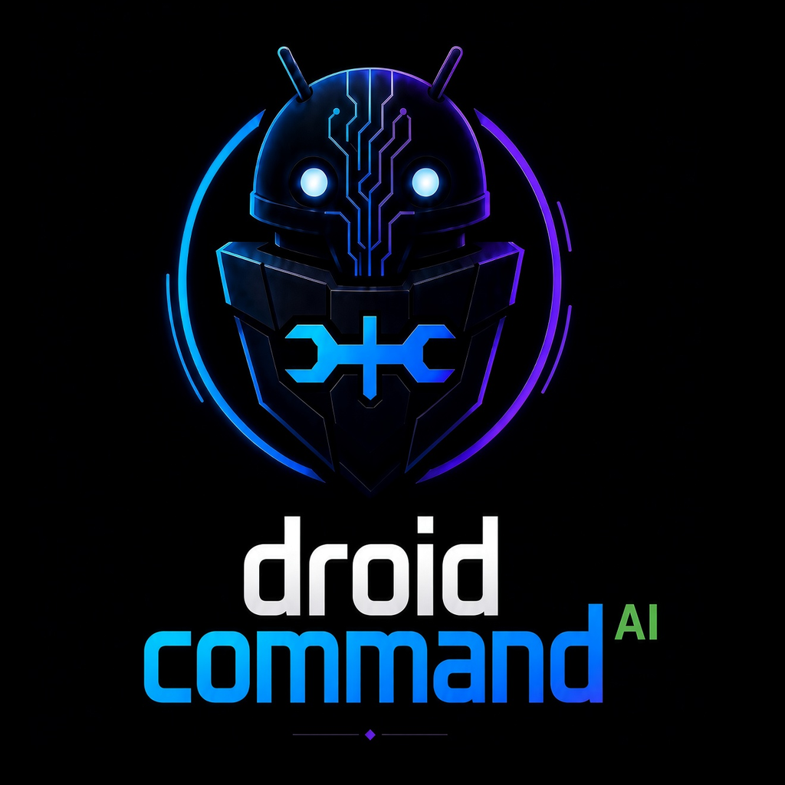
</p>

# droidcommand-AI

Fleet controller/brain — remote command and orchestration of every app in the Victorious fleet.

**Package id:** `ai.droidcommand.app`

**Status:** CI green / awaiting device test *(from [fleet-manifest ROADMAP](https://github.com/Victorious93/fleet-manifest/blob/main/ROADMAP.md))*

## Install / build

Kotlin / Jetpack Compose multi-module Gradle project. Typical: `./gradlew :app:assembleDebug` (requires Android SDK). See repo Gradle files for modules.

_Steps above are taken from this repo’s build files / existing docs; anything not exercised in this refresh is unlabeled as verified on a device._

## Victorious fleet

- Monorepo: [https://github.com/Victorious93/victorious-fleet](https://github.com/Victorious93/victorious-fleet)
- Fleet site: [https://victorious-framework.pages.dev](https://victorious-framework.pages.dev)

<!-- victorious-fleet-readme-refresh:end -->

<p align="center">
  <b>Chat with it. Plan with it. Let it command the rest of your fleet — under a strict security policy.</b>
</p>

<p align="center">
  <a href="https://github.com/Victorious93/droidcommand-AI/actions/workflows/ci.yml"></a>
  <a href="https://github.com/Victorious93/droidcommand-AI/actions/workflows/android-apk.yml"></a>
  <a href="https://github.com/Victorious93/droidcommand-AI/actions/workflows/android-emulator.yml"></a>
  
  
  
  
</p>

<p align="center">
  <a href="#-what-is-it">What is it</a> ·
  <a href="#-fleet-controller">Fleet</a> ·
  <a href="#-features">Features</a> ·
  <a href="#-screenshots">Screenshots</a> ·
  <a href="#-quick-start">Quick start</a> ·
  <a href="#-requirements">Requirements</a> ·
  <a href="#-signing">Signing</a> ·
  <a href="#-documentation-map">Docs</a> ·
  <a href="#-contributing">Contributing</a>
</p>

---

## 🧭 What is it

DroidCommand AI (DCA) is the **hub app** of a small fleet of independently installed Android apps. You talk to
it in chat; it can plan work, call tools under a strict security policy, run build/deploy (“Forge”) workflows,
and **command the member apps** — without folding those apps into this codebase.

Think of it as the controller. The other apps (HackerAI, RootForge OS, VictorSuite, EDL-Commander, and so on)
stay their own products. DroidCommand reaches them over a local connection. It does **not** replace them, and
uninstalling DroidCommand must not disable the independent members.

The project is a multi-module **Gradle** build written in **Kotlin**. The on-phone UI (`:app`) is **Jetpack
Compose**. Most of the engine is **pure Kotlin/JVM** and builds without an Android SDK; the Android modules need
the Android SDK and Android Gradle Plugin (AGP).

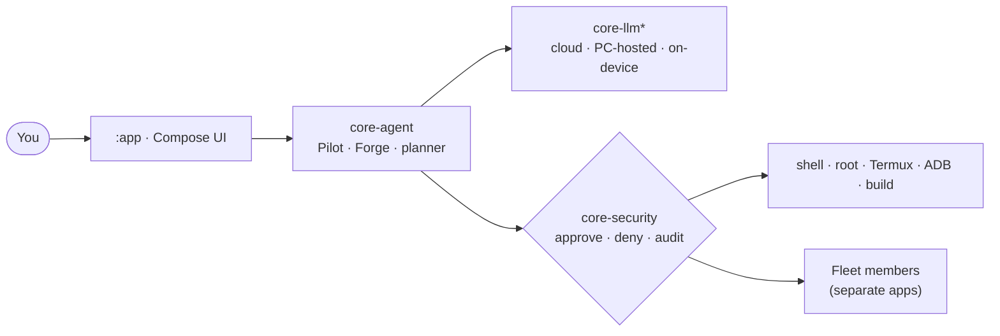

> **Status in one line:** the JVM engine is implemented and CI-tested. The Android debug APK is built in GitHub
> Actions and has been launched on an API 28 x86_64 emulator (launch smoke + primary-screen captures). It has
> **not** been run on a physical device. Live LLM calls, real device/root/Termux/Metasploit/SET backends and
> companion-APK bindings stay **UNVERIFIED**.

Authoritative status lives in [`docs/ARCHITECTURE.md`](docs/ARCHITECTURE.md) and
[`docs/AUDIT_2026-09-05.md`](docs/AUDIT_2026-09-05.md) (read the addenda at the bottom first). Session
orientation: [`CLAUDE.md`](CLAUDE.md).

## 🛰️ Fleet controller

DroidCommand is the **fleet controller**: the hub that lists the member apps and, when wiring is real, sends
them commands. It also **defines the connection class** of each member — the kind of relationship, which
decides how talking works and which security rules apply. Those classes live in
`core-security.KnownFleet` / `FleetIntegrationClass`. Full map: [`docs/FLEET_CONTROL.md`](docs/FLEET_CONTROL.md).
Companion bind protocol: [`COMPANION_PROTOCOL.md`](COMPANION_PROTOCOL.md).

> **Honest status:** none of the members is LIVE control. The Tools → Fleet screen only probes whether a
> package is installed. It does not run the member.

### Connection classes

| Class | Meaning |
|---|---|
| **`BOUND_COMPANION`** | A helper APK that binds to DroidCommand over AIDL, must share DroidCommand’s signing certificate, and is meant to stop working without the hub (`DependencyGuard`). |
| **`EXTERNAL_NODE`** | An independent product DroidCommand can ask questions of (Messenger + shared JSON). It must keep working if DroidCommand is uninstalled, and must **never** share DroidCommand’s signing key or get `DependencyGuard`. |
| **`TERMUX_IPC`** | Talks to VictorSuite the way Termux already allows: the public `com.termux.RUN_COMMAND` intent (plus plugin IPC). Not a new bound service. |
| **`HOST_PROCESS_TOOL`** | A program on this computer (localhost only), reached as a tool through `SecureToolExecutor`. Never AIDL, never `DependencyGuard`. |

AIDL + `DependencyGuard` apply **only** to bound companions (HackerAI, Pentest-Swarm-AI, EDL-Commander).
RootForge OS, Victorious File Manager, Victorious Keyboard, Victorious Mesh, Victorious Browser, VictorSuite and
KYC-AuditLab must not get them.

### Members

| Member | Repo | Class | How DCA reaches it | Status |
|---|---|---|---|---|
| **HackerAI** | [Victorious93/hackeraiETC](https://github.com/Victorious93/hackeraiETC) | Bound companion | AIDL `IHackerAIService`; `core-hackerai` | PARTIAL (not one of the nine room-fleet items) |
| **Pentest-Swarm-AI** | [Victorious93/Pentest-Swarm-AI](https://github.com/Victorious93/Pentest-Swarm-AI) | Bound companion | One command-envelope AIDL (planned). Older REST/AIDL copies in this repo are not LIVE | PLANNED |
| **VictorSuite** | `Victorious93/VictorSuite` (documented; not publicly resolvable 2026-10-14) | Termux IPC | `com.termux` + `RUN_COMMAND` / plugin IPC; gated on their PR #15 | PARTIAL |
| **RootForge OS** | [Victorious93/rootforge-os](https://github.com/Victorious93/rootforge-os) | External node | Their main already has Messenger + JSON (`ai.rootforge.os.action.BRIDGE`). This repo speaks SSH fallback only. No DependencyGuard, no shared signing key | PARTIAL |
| **KYC-AuditLab** | unpublished as of 2026-10-14 | Host process | `kyc_auditlab_status` stub — localhost simulator; hub must not call `/scope` admin | PLANNED |
| **EDL-Commander** | `Victorious93/EDL-Commander` (APK in progress) | Bound companion | Package `ai.edlcommander.companion`. `edl_commander_status` stub. AIDL `IEdlCompanion` copied; bind action `ai.edlcommander.companion.BIND`. Owns Sahara/Firehose | PLANNED |
| **Victorious File Manager** | [Victorious93/File-Manager](https://github.com/Victorious93/File-Manager) | External node | `filemanager_status` stub. Their main already has Messenger `ai.victorious.filemanager.action.BRIDGE`. This repo does not bind it. No DependencyGuard, no shared signing key | PLANNED |
| **Victorious Keyboard** | [Victorious93/Victorious-Keyboard](https://github.com/Victorious93/Victorious-Keyboard) | External node | `keyboard_status` stub. Planned Messenger `com.victorious.keyboard.action.BRIDGE`. This repo does not bind it. Never forwards typed text/keystrokes. No DependencyGuard, no shared signing key | PLANNED |
| **Victorious Mesh** | [Victorious93/victorious-mesh](https://github.com/Victorious93/victorious-mesh) | External node | `mesh_status` stub. Planned Messenger `com.victorious.mesh.action.BRIDGE`. Package `com.victorious.mesh` (debug==release). This repo does not bind it. Own release key. No DependencyGuard, no shared signing key | PLANNED |
| **Victorious Browser** | unpublished as of 2026-10-18 (repo not in ratified facts) | External node | `browser_status` stub. Planned Messenger `com.victorious.browser.action.BRIDGE`. Package `com.victorious.browser`. This repo does not bind it. Own release key (CI-only; [planned/unverified]). No DependencyGuard, no shared signing key | PLANNED |

Companion binding glue (`:core-companion`) needs the Android SDK, so it is in the opt-in Android block, not the
default JVM build.

## ✨ Features

Honesty grades: **IMPLEMENTED / PARTIAL / STUB / PLANNED** — see the audit docs. A feature is not “working”
here unless the audit says what was actually run.

| Area | What exists in-repo |
|---|---|
| 🧠 **Agent core** | State machine, tool registry/executor, planner, Forge objective loop, Pilot/Forge session (`core-agent`) |
| 🔌 **LLM providers** | Anthropic, OpenAI, Google Gemini, Groq, on-device (llama.cpp/GGUF), and **PC-hosted** models (Ollama / OpenAI-compatible) behind one factory; an owner **inference policy** decides where text may go ([`docs/INFERENCE_POLICY.md`](docs/INFERENCE_POLICY.md), [`docs/PC_HOSTED_MODELS.md`](docs/PC_HOSTED_MODELS.md)). Mock-server tests — **no live API calls in CI** |
| 🛡️ **Security** | Fail-closed `SecurityPolicyEnforcer` / `SecureToolExecutor` (allow / require-approval / deny), grants, audit log, secrets vault ([`docs/SECURITY.md`](docs/SECURITY.md)) |
| 🔨 **Build & deploy (Forge)** | Workspace/pipeline, local process executor (refuses Android project type), remote build delegation, APK lifecycle pipeline (real device executor PLANNED) |
| 📱 **Execution targets** | Android device-control tools (ADB seam), shell allow-list, root-gated tools (`NullRootExecutor` default), Termux `RUN_COMMAND`, Shizuku |
| 🧰 **Security-tooling clients** | HackerAI, Pentest-Swarm, Metasploit and SET modules — all routed through the secure executor |
| 🤖 **Bots & skills** | Helper-bot maker, skills, templates, MCP client, n8n bridge |
| 📚 **Knowledge** | Conversations (Room), RAG, knowledge graph, on-device Markdown notes vault (`core-notes`), web search |
| 🎙️ **Voice** | STT/TTS logic and on-device neural voice wrappers (never run on a device) |
| 💬 **Communications** | `core-communications`: owner-grant based `communications.*` capabilities for VictorBots/VictorSMS — JVM-tested; Android transport built but never run ([`docs/COMPANION_COMMS.md`](docs/COMPANION_COMMS.md)) |
| ⚙️ **System Settings** | Typed System/Secure/Global editor with journal, readback and rollback ([`docs/SYSTEM_SETTINGS.md`](docs/SYSTEM_SETTINGS.md)) |
| 💳 **Billing** | Entitlement logic (`core-billing`); Play Billing glue and UI not built |
| ⌨️ **CLI** | Device-free Pilot/Forge entrypoint (`:cli`) |

## 📸 Screenshots

Captured 2026-10-14 on an API 28 x86_64 emulator (AVD `dca_ui`, TCG — this
host’s KVM hits `kvm_arch_vcpu_create`). Sources: instrumented
`PrimaryScreensScreenshotTest` (production `MainActivity`) and
`adb exec-out screencap` after tapping the real bottom bar. Reproduce with
`./scripts/capture-app-screenshots.sh`. Tool backends are the existing
`Null*` stubs — nothing here executed real root, Termux, Metasploit, or SET.

| Chat (Pilot) | Tool approval | Forge build run | Memory / knowledge | Settings / providers | Notes vault |
|---|---|---|---|---|---|
| 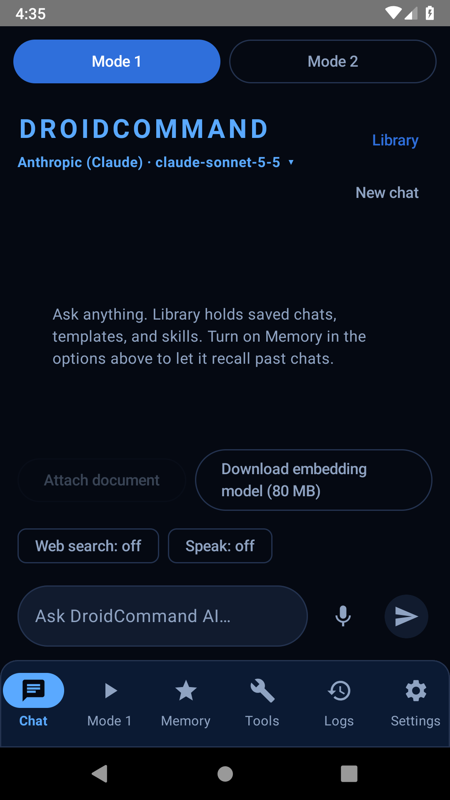 | *UNVERIFIED* — Confirm action dialog not captured. Pilot `run_root_command` was denied (`root is disabled for this session`) before a prompt. The Metasploit form did not reach Run Module via coordinate taps on TCG. | 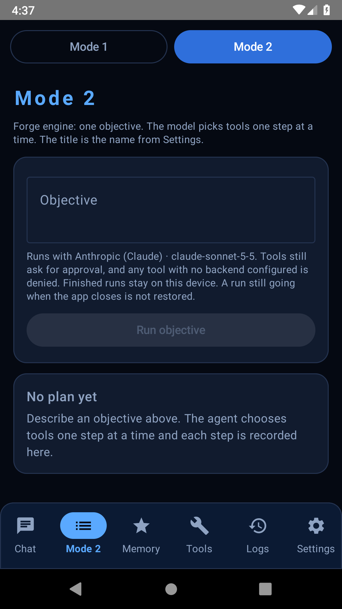<br>*Empty Forge UI.* A finished build run needs a live LLM — UNVERIFIED. | 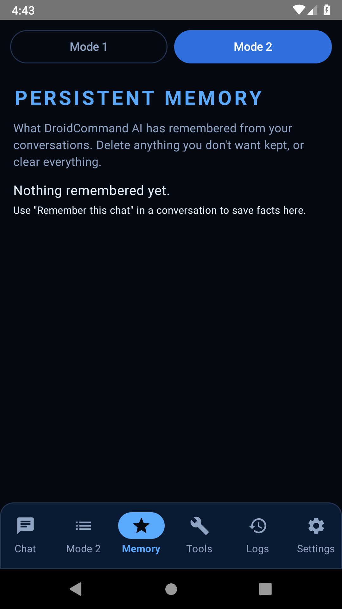 | 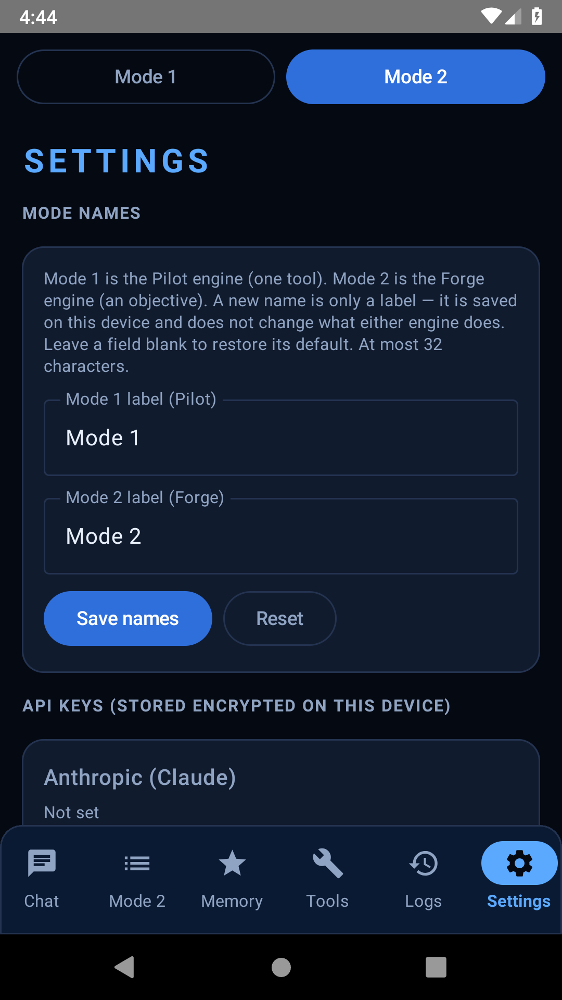 | 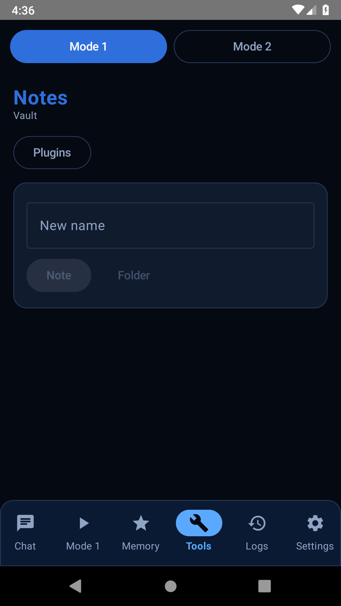 |

Additional screens from the same emulator session (not in the table above):

| Tools | Metasploit (Null backend) | Pilot engine | System Logs |
|---|---|---|---|
| 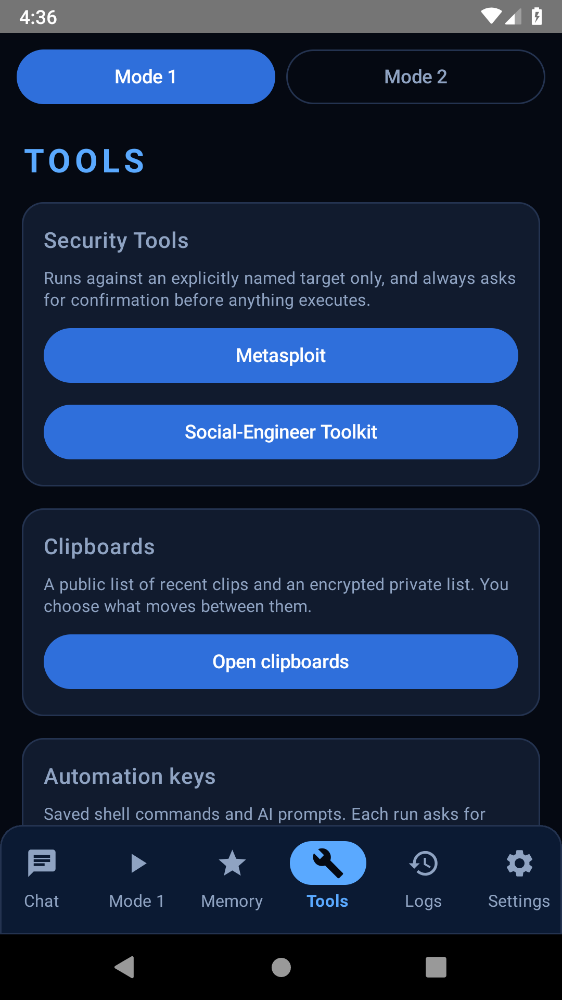 | 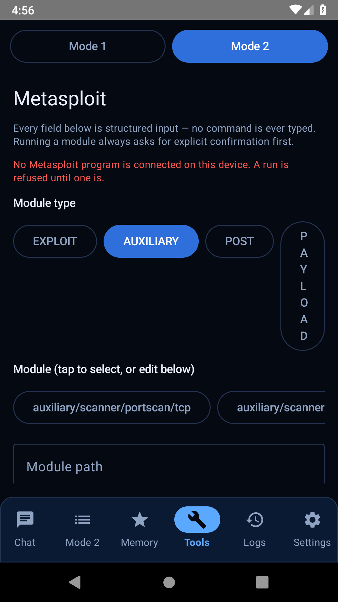 | 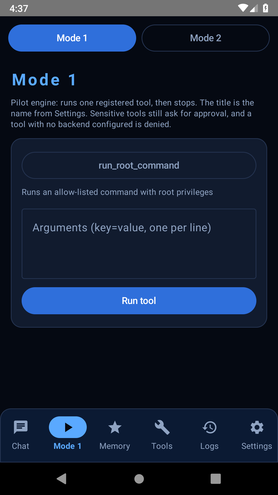 | 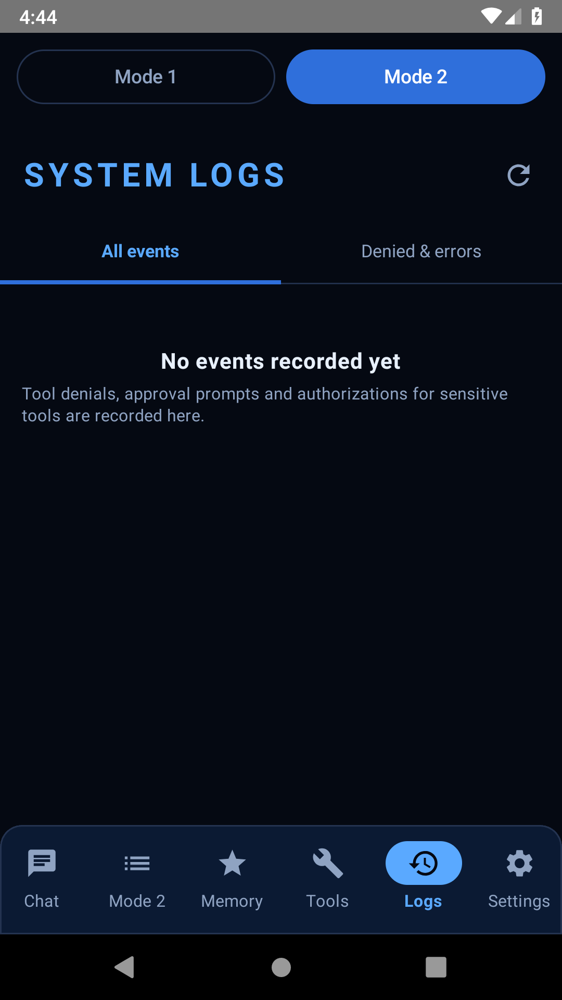 |

Still UNVERIFIED on emulator and device: live chat against a real provider, a
finished Forge run, the Confirm-action dialog, Social-Engineer Toolkit,
clipboards / automation / coding, voice, GGUF load, and any `Null*` backend
executing for real.

Walkthrough screenshots of the bot maker, Advanced and System Settings screens live in
[`docs/images/manual`](docs/images/manual) and [`docs/images/system-settings`](docs/images/system-settings),
used by the [user manual](docs/MANUAL.md).

## 🚀 Quick start

Default Gradle includes only the JVM modules. These are the commands CI actually runs; this README does not
invent extra ones and does not claim they were re-run when it was written.

```sh
# JVM modules + tests            (.github/workflows/ci.yml)
./gradlew test --continue
./gradlew ktlintCheck --continue

# Android modules' unit tests    (.github/workflows/android-checks.yml; needs SDK/AGP)
./gradlew -PincludeAndroid=true testDebugUnitTest ktlintCheck --continue

# Debug APK                      (.github/workflows/android-apk.yml; needs SDK/AGP + NDK/CMake)
./gradlew :app:assembleDebug -PincludeAndroid=true
# → app/build/outputs/apk/debug/app-debug.apk

# Smaller, phone-sized debug APK (drops x86 / x86_64 / armeabi-v7a native libs)
./gradlew :app:assembleDebug -PincludeAndroid=true -PabiFilter=arm64-v8a

# Device-free CLI (JVM; no Android SDK)
./gradlew :cli:run --args="list-fleet"
./gradlew :cli:run --args="pilot echo text=hello"
./gradlew :cli:run --args="--help"
```

The debug APK bundles native llama.cpp and sherpa-onnx libraries and is large (hundreds of MB with all ABIs
packed). CI’s default is the 4-ABI artifact; `-PabiFilter=arm64-v8a` is the phone-sized one. There is **no**
`assembleRelease` job in the workflows, and `app/build.gradle.kts` does not configure a release `signingConfig`.
First time on a real phone? Read [`docs/FIRST_DEVICE_RUN.md`](docs/FIRST_DEVICE_RUN.md) (written from the code,
not run).

## 🧱 Requirements

**JVM engine** (always included — see `settings.gradle.kts`)

- JDK **21** (CI: Temurin 21)

**Android APK** (opt-in: `-PincludeAndroid=true`, or `includeAndroid=true` in user-level `~/.gradle/gradle.properties`)

- Android SDK: `platforms;android-36`, `build-tools;36.0.0`, `platform-tools`
- NDK `28.2.13676358` (r28c) and CMake `3.22.1` (llama.cpp + sherpa-onnx native builds)
- AGP **8.13.2**, Kotlin **2.4.10**, Compose compiler plugin **2.4.10**
- `:app`: `applicationId` `ai.droidcommand.app`, `minSdk` 28, `compileSdk`/`targetSdk` 36,
  `versionName` `0.1.11`, Jetpack Compose

## 🔏 Signing

Details: [`docs/SIGNING.md`](docs/SIGNING.md). Debug fingerprint also
re-checked against the committed keystore with `keytool` (alias
`androiddebugkey`, `CN=DroidCommand Debug`).

**Debug (committed, DEBUG ONLY)**

`signing/droidcommand-debug.keystore` is DroidCommand’s **own** debug
identity. It is committed on purpose. It is **not** a secret, **not** a
release key, and **not** a shared fleet keystore.

- Alias: `androiddebugkey`
- Store/key password: `android`
- Distinguished name: `CN=DroidCommand Debug`
- Certificate SHA-256:
  `88:00:51:A6:D9:5D:38:DD:8D:81:E1:93:1E:17:05:48:03:87:D5:93:C3:09:43:53:99:68:E6:EF:11:A0:C8:4D`

`:app`’s debug `signingConfig` points at this file
(`app/build.gradle.kts`). Every CI debug APK and every local
`./gradlew :app:assembleDebug` should carry that fingerprint, so a new
debug build installs over an older one.

If an older debug APK was built before this key existed, uninstall
`ai.droidcommand.app` once; those used a random CI debug key.

**Release (not in this repository)**

The RELEASE key lives **only in CI secrets** and is **never committed**.
`app/build.gradle.kts` does not point at a release keystore.
[`docs/SIGNING.md`](docs/SIGNING.md) says not to reuse the debug keystore
— or any fleet companion key — for release builds.

Bound companions (HackerAI, Pentest-Swarm, EDL-Commander when it lands)
must share DroidCommand’s **production** certificate so Android
`protectionLevel="signature"` binds work
([`COMPANION_PROTOCOL.md`](COMPANION_PROTOCOL.md) “Sign and install both
APKs with the same key”). Independent members (`EXTERNAL_NODE`,
`TERMUX_IPC`, `HOST_PROCESS_TOOL`) must **not** share that key
([`docs/FLEET_CONTROL.md`](docs/FLEET_CONTROL.md)).

- **[Likely]** release APKs of this app are signed with the shared fleet
  **release** key, certificate SHA-256 `9E:A7:B3:14:…:2D:8D`. That
  fingerprint is **not recorded** in this repository’s files
  (`docs/SIGNING.md`, `app/build.gradle.kts`, the committed debug
  keystore). Treat it as fleet-operator knowledge, not as something Gradle
  in this tree can prove.

## 🗂️ Project structure

```text
core-agent/          Agent session, tools, planner, Forge/Pilot
core-llm*/           Provider-independent LLM stack + vendor modules (+ local, factory, routing)
core-security*/      Policy enforcement, secure tool execution, KnownFleet
core-build*/         Forge build/deploy pipeline
core-tools-android/  Device-control tools (ADB seam)
core-termux/ core-root/ core-shizuku/   Execution targets
core-fleet-*/        Fleet messenger, tools, worker, update
core-companion/      AIDL contracts (Android; opt-in)
core-*/              RAG, voice, notes, skills, bots, communications, system-settings, …
cli/                 Device-free entrypoint
app/                 Jetpack Compose UI + Hilt (Android; opt-in)
tools/pc-companion/  PC-side companion (module :pc-companion)
signing/             Committed DEBUG keystore only
docs/                Architecture, audit, security, fleet, manual, integration plans
```

`settings.gradle.kts` is the source of truth: **54** modules are always included. Android modules join with
`-PincludeAndroid=true`: `:app`, `:core-conversations`, `:core-companion`, `:core-rag-android`,
`:core-templates-android`, `:core-knowledge-android`, `:core-llm-local-android`, `:core-voice-android`,
`:core-voice-neural-android`. Re-check the file before trusting these counts as they age.

## 📖 Documentation map

| Start here | For |
|---|---|
| [`docs/MANUAL.md`](docs/MANUAL.md) | Using the app (screens, bots, safety) + remote-control reference |
| [`docs/ARCHITECTURE.md`](docs/ARCHITECTURE.md) | Per-component status |
| [`docs/AUDIT_2026-09-05.md`](docs/AUDIT_2026-09-05.md) | Requirements matrix and dated addenda (newest at the bottom) |
| [`docs/SECURITY.md`](docs/SECURITY.md) | Storage, networking, secrets, logging, tool execution |
| [`docs/FLEET_CONTROL.md`](docs/FLEET_CONTROL.md) · [`COMPANION_PROTOCOL.md`](COMPANION_PROTOCOL.md) | Fleet classes and the AIDL contract |
| [`docs/INFERENCE_POLICY.md`](docs/INFERENCE_POLICY.md) · [`docs/PC_HOSTED_MODELS.md`](docs/PC_HOSTED_MODELS.md) | Where model calls may go |
| [`docs/ON_DEVICE_GGUF_CHECKLIST.md`](docs/ON_DEVICE_GGUF_CHECKLIST.md) · [`docs/FIRST_DEVICE_RUN.md`](docs/FIRST_DEVICE_RUN.md) | Device checklists |
| [`docs/SIGNING.md`](docs/SIGNING.md) | Debug vs release signing |
| [`docs/KAI_INTEGRATION.md`](docs/KAI_INTEGRATION.md) · [`docs/KAI_INTEGRATION_PLAN.md`](docs/KAI_INTEGRATION_PLAN.md) | Kai capability map and phased plan (Phase 2 needs owner approval) |

## 🏷️ Status conventions

Every intentional non-real implementation is named as such (`Mock*`, `Null*`). A component is **IMPLEMENTED**
only when `./gradlew test` passes for it. Device, root, live LLM credentials and on-device execution stay
**PLANNED / UNVERIFIED** rather than faked. Read the audit addenda before assuming any capability is complete.

## 🤝 Contributing

1. Work on a branch and open a PR; never push to `main`. Merge only when every check is green.
2. Keep status honesty: don’t mark device-only work IMPLEMENTED without evidence.
3. Prefer pure-Kotlin cores with tests; thin Android shells.
4. Security-sensitive paths (tool execution, secrets, logging) stay fail-closed.
5. Companion protocol changes need coordinated copies in companion repos — see `COMPANION_PROTOCOL.md`.
6. Don’t mix bound-companion, external-node, Termux and host-process classes — see `docs/FLEET_CONTROL.md`.
7. Never commit secrets (API keys, tokens, keystore passwords, `.env`).

## 📜 License

**This repository does not currently ship a `LICENSE` file.** Companion apps are independently licensed
(notably Pentest-Swarm-AI from AGPL-3.0 upstream; VictorSuite from Termux/GPLv3). DCA integrates across process
boundaries and does not vendor their source. Until a license is chosen, treat redistribution and contribution
terms as undefined — add an SPDX license file before a public release.

---

<p align="center"><sub>Victorious Framework · droidcommand-AI</sub></p>
