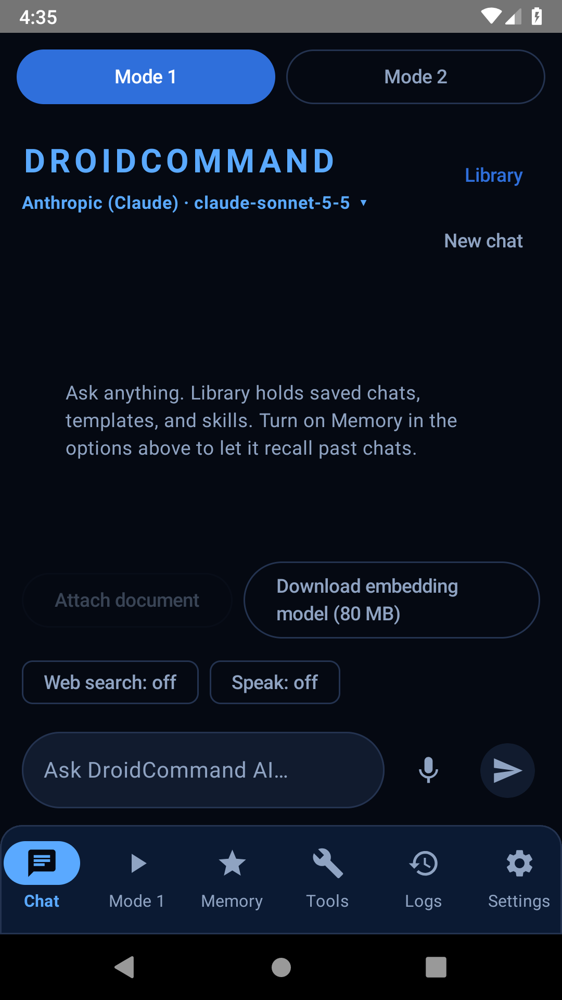
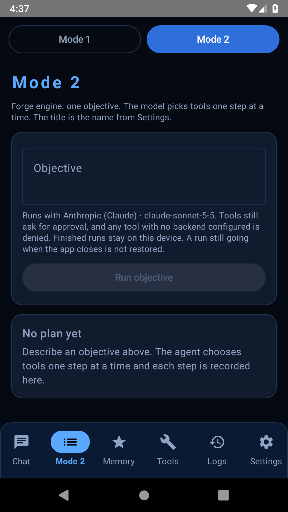
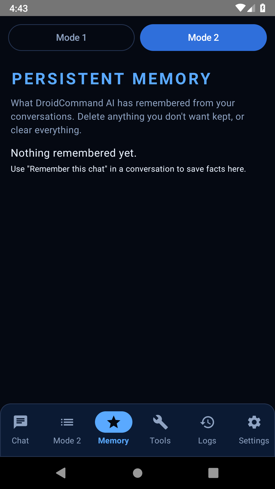
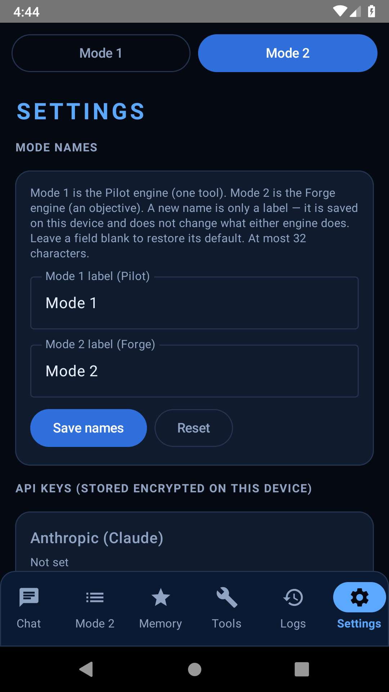
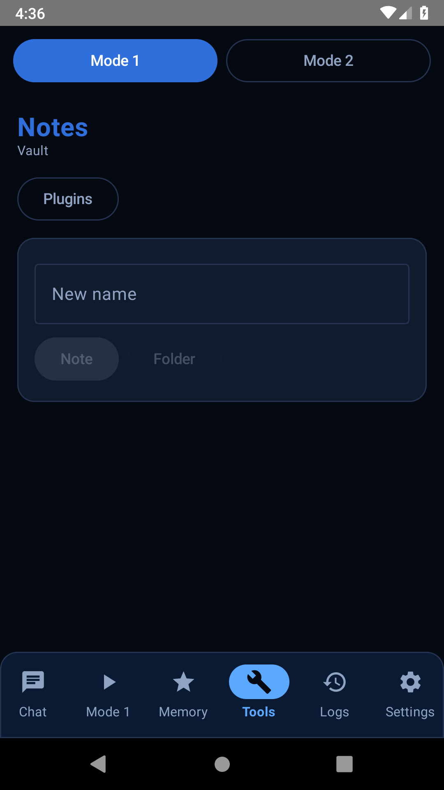
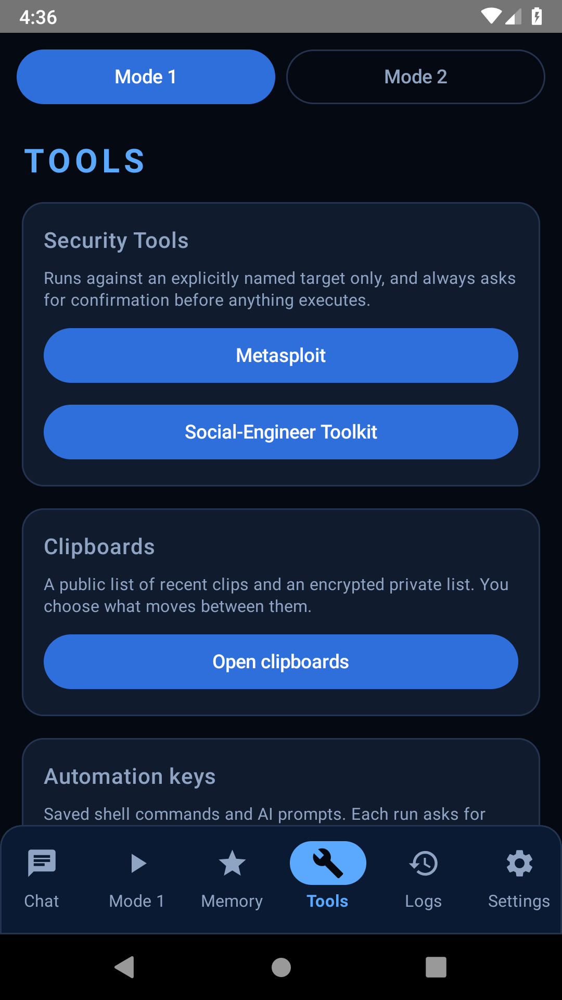
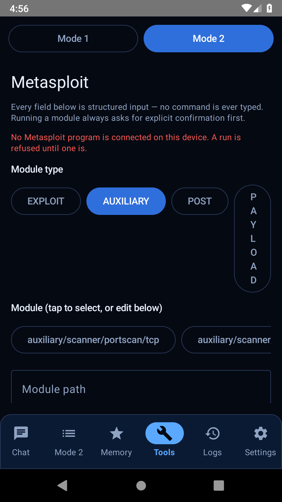
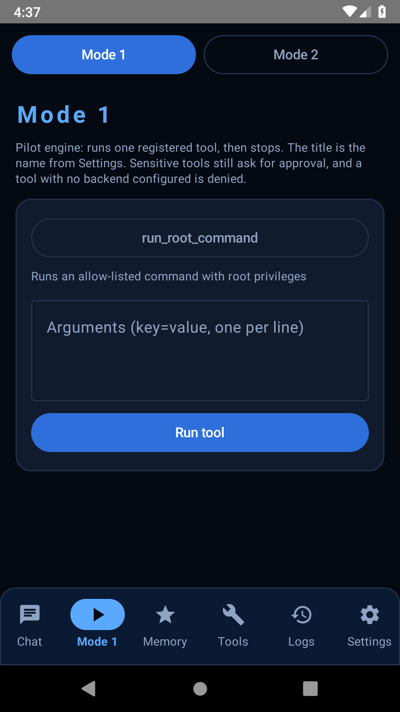
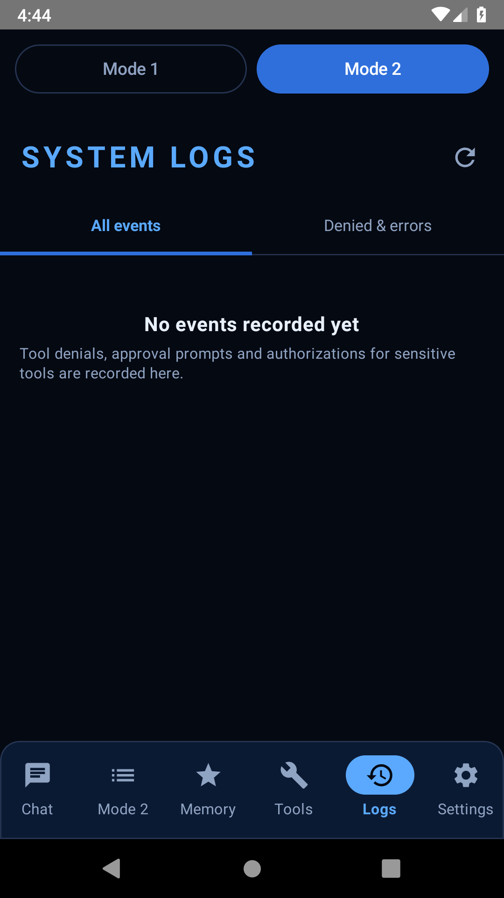

<p align="center">
  
</p>

# DroidCommand AI

DroidCommand AI (DCA) is the **hub app** of a small fleet of independently
installed Android apps. You talk to it in chat; it can plan work, call tools
under a strict security policy, run build/deploy (“Forge”) workflows, and
**command the member apps** — without folding those apps into this codebase.

Think of it as the controller. The other apps (HackerAI, RootForge OS,
VictorSuite, EDL-Commander, and so on) stay their own products. DroidCommand
reaches them over a local connection. It does **not** replace them, and
uninstalling DroidCommand must not disable the independent members.

The project is a multi-module **Gradle** build, written in **Kotlin**. The
on-phone UI (`:app`) is **Jetpack Compose**. Most of the engine is
**pure Kotlin/JVM** and builds without an Android SDK. The Android modules
need the Android SDK and Android Gradle Plugin (AGP).

> **Status in one line:** the JVM engine is implemented and CI-tested; the
> Android debug APK is built in GitHub Actions and has been launched on an
> API 28 x86_64 emulator (launch smoke + primary-screen captures); it has
> **not** been run on a physical device. Live LLM calls, real
> device/root/Termux/Metasploit/SET backends, and companion-APK bindings stay
> UNVERIFIED.

Authoritative status: [`docs/ARCHITECTURE.md`](docs/ARCHITECTURE.md),
[`docs/AUDIT_2026-09-05.md`](docs/AUDIT_2026-09-05.md). Session orientation /
roadmap: [`CLAUDE.md`](CLAUDE.md).

## Fleet controller

DroidCommand is the **fleet controller**: the hub that lists the member apps
and, when wiring is real, sends them commands. It also **defines the
connection class** of each member — the kind of relationship, which decides
how talking works and which security rules apply. Those classes live in
`core-security.KnownFleet` / `FleetIntegrationClass`. Full map:
[`docs/FLEET_CONTROL.md`](docs/FLEET_CONTROL.md). Companion bind protocol:
[`COMPANION_PROTOCOL.md`](COMPANION_PROTOCOL.md).

Honest status: **none of the members is LIVE control**. The Tools → Fleet
screen only probes whether a package is installed. It does not run the
member.

### Connection classes (one line each)

Defined in code as `BOUND_COMPANION`, `EXTERNAL_NODE`, `TERMUX_IPC`, and
`HOST_PROCESS_TOOL`:

- **BOUND_COMPANION** — a helper APK that binds to DroidCommand over AIDL,
  must share DroidCommand’s signing certificate, and is meant to stop working
  without the hub (`DependencyGuard`).
- **EXTERNAL_NODE** — an independent product DroidCommand can ask questions
  of (Messenger + shared JSON). It must keep working if DroidCommand is
  uninstalled, and it must **never** share DroidCommand’s signing key or get
  `DependencyGuard`.
- **TERMUX_IPC** — talks to VictorSuite the same way Termux already allows:
  the public `com.termux.RUN_COMMAND` intent (plus plugin IPC). Not a new
  bound service.
- **HOST_PROCESS_TOOL** — a program on this computer (localhost only),
  reached as a tool through `SecureToolExecutor`. Never AIDL, never
  `DependencyGuard`.

AIDL + `DependencyGuard` apply **only** to bound companions (HackerAI,
Pentest-Swarm-AI, EDL-Commander). RootForge OS, Victorious File Manager,
Victorious Keyboard, VictorSuite, and KYC-AuditLab must not get them.

| Member | Repo | Class | How DCA reaches it | Status |
|---|---|---|---|---|
| **HackerAI** | [Victorious93/hackeraiETC](https://github.com/Victorious93/hackeraiETC) | Bound companion | AIDL `IHackerAIService`; `core-hackerai` | PARTIAL (not one of the seven room-fleet items) |
| **Pentest-Swarm-AI** | [Victorious93/Pentest-Swarm-AI](https://github.com/Victorious93/Pentest-Swarm-AI) | Bound companion | One command-envelope AIDL (planned). Older REST/AIDL copies in this repo are not LIVE | PLANNED |
| **VictorSuite** | `Victorious93/VictorSuite` (documented; not publicly resolvable 2026-10-14) | Termux IPC | `com.termux` + `RUN_COMMAND` / plugin IPC; gated on their PR #15 | PARTIAL |
| **RootForge OS** | [Victorious93/rootforge-os](https://github.com/Victorious93/rootforge-os) | External node | Their main already has Messenger + JSON (`ai.rootforge.os.action.BRIDGE`). This repo speaks SSH fallback only. No DependencyGuard, no shared signing key | PARTIAL |
| **KYC-AuditLab** | unpublished as of 2026-10-14 | Host process | `kyc_auditlab_status` stub — localhost simulator; hub must not call `/scope` admin | PLANNED |
| **EDL-Commander** | `Victorious93/EDL-Commander` (APK in progress) | Bound companion | `edl_commander_status` stub. AIDL + same-signing when the APK lands. Owns Sahara/Firehose | PLANNED |
| **Victorious File Manager** | [Victorious93/File-Manager](https://github.com/Victorious93/File-Manager) | External node | `filemanager_status` stub. Their main already has Messenger `ai.victorious.filemanager.action.BRIDGE`. This repo does not bind it. No DependencyGuard, no shared signing key | PLANNED |
| **Victorious Keyboard** | [Victorious93/Victorious-Keyboard](https://github.com/Victorious93/Victorious-Keyboard) | External node | `keyboard_status` stub. Planned Messenger `com.victorious.keyboard.action.BRIDGE`. This repo does not bind it. Never forwards typed text/keystrokes. No DependencyGuard, no shared signing key | PLANNED |

Companion binding glue (`:core-companion`) needs the Android SDK and is
**not** in the default JVM build. It is also **not** in the
`includeAndroid=true` block in `settings.gradle.kts` (the opt-in Android
modules are `:app` and the Android libraries listed there).

## Features (what exists in-repo)

Honesty grades: IMPLEMENTED / PARTIAL / STUB / PLANNED — see audit docs.
Highlights of modules that exist:

- **Agent core** — state machine, tool registry/executor, Planner, Forge
  objective loop, Pilot/Forge session (`core-agent`)
- **LLM providers** — Anthropic, OpenAI, Google Gemini, Groq, local seam;
  factory composition; mock-server tests (**no live API calls in CI**)
- **Security** — fail-closed `SecurityPolicyEnforcer` / `SecureToolExecutor`
  (allow / require-approval / deny; root & permission gating)
- **Build & deploy (Forge)** — workspace/pipeline, local process executor
  (refuses Android project type), remote build delegation, APK lifecycle
  pipeline (real device executor PLANNED)
- **Execution targets** — Android device-control tools (`DeviceController`
  seam; growing `AdbDeviceController` implementations), shell allow-list,
  root-gated tools (`NullRootExecutor` default), Termux `RUN_COMMAND`
- **Security tooling clients** — HackerAI, Pentest-Swarm, Metasploit/SET
  toolkit modules (route through secure executor)
- **Product features** — templates/skills, RAG, web search, voice STT/TTS
  logic, billing entitlements, prompt regen, conversations (Room), knowledge
  graph (Android), **on-device markdown notes vault** (`core-notes`)
- **CLI** — device-free Pilot/Forge entrypoint (`:cli`)

## Screenshots

Captured 2026-10-14 on an API 28 x86_64 emulator (AVD `dca_ui`, TCG — this
host’s KVM hits `kvm_arch_vcpu_create`). Sources: instrumented
`PrimaryScreensScreenshotTest` (production `MainActivity`) and
`adb exec-out screencap` after tapping the real bottom bar. Reproduce with
`./scripts/capture-app-screenshots.sh`. Tool backends are the existing
`Null*` stubs — nothing here executed real root, Termux, Metasploit, or SET.

| Chat (Pilot) | Tool approval | Forge build run | Memory / knowledge | Settings / providers | Notes vault |
|---|---|---|---|---|---|
|  | *UNVERIFIED* — Confirm action dialog not captured. Pilot `run_root_command` was denied (`root is disabled for this session`) before a prompt. The Metasploit form did not reach Run Module via coordinate taps on TCG. | <br>*Empty Forge UI.* A finished build run needs a live LLM — UNVERIFIED. |  |  |  |

Additional screens from the same emulator session (not in the table above):

| Tools | Metasploit (Null backend) | Pilot engine | System Logs |
|---|---|---|---|
|  |  |  |  |

Still UNVERIFIED on emulator and device: live chat against a real provider, a
finished Forge run, the Confirm-action dialog, Social-Engineer Toolkit,
clipboards / automation / coding, voice, GGUF load, and any `Null*` backend
executing for real.

## Requirements

**JVM engine** (always included — see `settings.gradle.kts`)

- JDK **21** (CI: Temurin 21; `.github/workflows/ci.yml`)

**Android APK** (opt-in: `-PincludeAndroid=true`, or `includeAndroid=true` in
user-level `~/.gradle/gradle.properties`)

- Android SDK packages matching `.github/workflows/android-apk.yml`:
  `platforms;android-36`, `build-tools;36.0.0`, `platform-tools`
- NDK `ndk;28.2.13676358` (r28c) and CMake `cmake;3.22.1` (llama.cpp +
  sherpa-onnx native builds)
- AGP **8.13.2**, Kotlin **2.4.10**, Compose compiler plugin **2.4.10**
  (`settings.gradle.kts` `pluginManagement`)
- `:app` (`app/build.gradle.kts`): `applicationId` `ai.droidcommand.app`,
  `minSdk` 28, `compileSdk`/`targetSdk` 36, `versionName` `0.1.0-phase0`,
  Jetpack Compose enabled

## Build and run

Default Gradle includes only the JVM modules. Android modules join when
`includeAndroid=true` (`settings.gradle.kts`). These are the commands CI
actually runs — this README does not invent extra ones, and it does not
claim they were re-run in the session that wrote it.

```sh
# JVM modules + tests (default CI: .github/workflows/ci.yml)
./gradlew test --continue
./gradlew ktlintCheck --continue

# Android modules' unit tests + ktlint (needs SDK/AGP)
# .github/workflows/android-checks.yml
./gradlew -PincludeAndroid=true testDebugUnitTest ktlintCheck --continue

# Android debug APK (needs SDK/AGP + NDK/CMake)
# .github/workflows/android-apk.yml
./gradlew :app:assembleDebug -PincludeAndroid=true
# → app/build/outputs/apk/debug/app-debug.apk

# Smaller phone-sized debug APK (x86 / x86_64 / armeabi-v7a native libs dropped)
./gradlew :app:assembleDebug -PincludeAndroid=true -PabiFilter=arm64-v8a

# Device-free CLI (JVM; no Android SDK). Examples from cli/.../Main.kt:
./gradlew :cli:run --args="list-fleet"
./gradlew :cli:run --args="pilot echo text=hello"
./gradlew :cli:run --args="--help"
```

The debug APK bundles native llama.cpp and sherpa-onnx libraries and is
large (hundreds of MB when all ABIs are packed). The 4-ABI artifact is
CI’s default; `abi=arm64-v8a` / `-PabiFilter=arm64-v8a` is the phone-sized
one. An x86_64 build has been launched on an API 28 emulator (see
Screenshots and `.github/workflows/android-emulator.yml`); it has not been
installed on a physical device.

There is **no** `assembleRelease` job in the workflows, and
`app/build.gradle.kts` does not configure a release `signingConfig`.

## Signing

Details: [`docs/SIGNING.md`](docs/SIGNING.md). Debug fingerprint also
re-checked against the committed keystore with `keytool` (alias
`androiddebugkey`, `CN=DroidCommand Debug`).

**Debug (committed, DEBUG ONLY)**

`signing/droidcommand-debug.keystore` is DroidCommand’s **own** debug
identity. It is committed on purpose. It is **not** a secret, **not** a
release key, and **not** a shared fleet keystore.

- Alias: `androiddebugkey`
- Store/key password: `android`
- Distinguished name: `CN=DroidCommand Debug`
- Certificate SHA-256:
  `88:00:51:A6:D9:5D:38:DD:8D:81:E1:93:1E:17:05:48:03:87:D5:93:C3:09:43:53:99:68:E6:EF:11:A0:C8:4D`

`:app`’s debug `signingConfig` points at this file
(`app/build.gradle.kts`). Every CI debug APK and every local
`./gradlew :app:assembleDebug` should carry that fingerprint, so a new
debug build installs over an older one.

If an older debug APK was built before this key existed, uninstall
`ai.droidcommand.app` once; those used a random CI debug key.

**Release (not in this repository)**

The RELEASE key lives **only in CI secrets** and is **never committed**.
`app/build.gradle.kts` does not point at a release keystore.
[`docs/SIGNING.md`](docs/SIGNING.md) says not to reuse the debug keystore
— or any fleet companion key — for release builds.

Bound companions (HackerAI, Pentest-Swarm, EDL-Commander when it lands)
must share DroidCommand’s **production** certificate so Android
`protectionLevel="signature"` binds work
([`COMPANION_PROTOCOL.md`](COMPANION_PROTOCOL.md) “Sign and install both
APKs with the same key”). Independent members (`EXTERNAL_NODE`,
`TERMUX_IPC`, `HOST_PROCESS_TOOL`) must **not** share that key
([`docs/FLEET_CONTROL.md`](docs/FLEET_CONTROL.md)).

- **[Likely]** release APKs of this app are signed with the shared fleet
  **release** key, certificate SHA-256 `9E:A7:B3:14:…:2D:8D`. That
  fingerprint is **not recorded** in this repository’s files
  (`docs/SIGNING.md`, `app/build.gradle.kts`, the committed debug
  keystore). Treat it as fleet-operator knowledge, not as something Gradle
  in this tree can prove.

## Project structure

```text
core-agent/          Agent session, tools, planner, Forge/Pilot
core-llm*/           Provider-independent LLM stack + vendor modules
core-security/       Policy enforcement, secure tool execution, KnownFleet
core-build*/         Forge build/deploy pipeline
core-tools-android/  Device-control tools (ADB seam)
core-termux/         Termux RUN_COMMAND protocol
core-companion/      AIDL contracts (on disk; not in the Gradle include list)
core-*/              RAG, voice, templates, notes, root, rootforge, …
cli/                 Device-free entrypoint
app/                 Jetpack Compose UI + Hilt (Android opt-in)
signing/             Committed DEBUG keystore only
docs/                Architecture, audit, security, fleet, integration plans
```

Default build = JVM modules listed in `settings.gradle.kts`. Android
modules join with `-PincludeAndroid=true`: `:app`, `:core-conversations`,
`:core-rag-android`, `:core-templates-android`, `:core-knowledge-android`,
`:core-llm-local-android`, `:core-voice-android`,
`:core-voice-neural-android`.

## Status conventions

Every intentional non-real implementation is named as such (`Mock*`,
`Null*`). A component is IMPLEMENTED only when `./gradlew test` passes for
it. Device, root, live LLM credentials, and on-device execution stay
PLANNED / UNVERIFIED rather than faked. Read
`docs/AUDIT_2026-09-05.md` (addenda first) before assuming any capability
is complete.

## Contributing

1. Keep status honesty: do not mark device-only work as IMPLEMENTED without
   evidence.
2. Prefer pure-Kotlin cores with tests; thin Android shells.
3. Security-sensitive paths (tool execution, secrets, logging) must stay
   fail-closed.
4. Companion protocol changes need coordinated copies in companion repos —
   see `COMPANION_PROTOCOL.md`.
5. Bound-companion vs external-node vs Termux vs host-process classes must
   not be mixed. See `docs/FLEET_CONTROL.md`.

## License

**This repository does not currently ship a `LICENSE` file.** Companion
apps are independently licensed (notably Pentest-Swarm-AI from AGPL-3.0
upstream; VictorSuite from Termux/GPLv3). DCA integrates across process
boundaries and does not vendor their source.

Until a license is chosen and added, treat redistribution/contribution
terms as undefined — add an SPDX license file before a public release.
