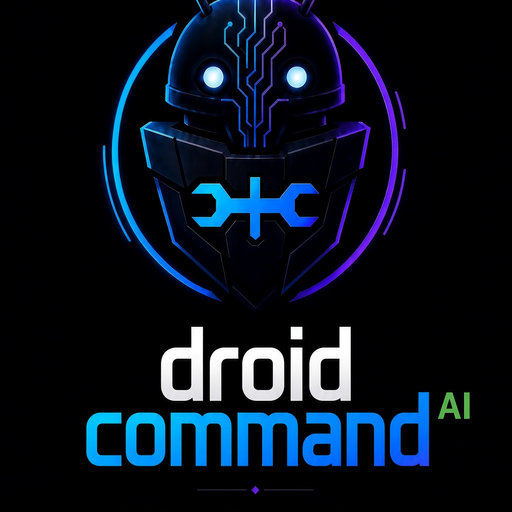

<!-- victorious-fleet-readme-refresh:start -->
<p align="center">
  
</p>

# droidcommand-AI

Fleet controller/brain — remote command and orchestration of every app in the Victorious fleet.

**Package id:** `ai.droidcommand.app`

**Status:** CI green / awaiting device test *(from [fleet-manifest ROADMAP](https://github.com/Victorious93/fleet-manifest/blob/main/ROADMAP.md))*

## Install / build

Kotlin / Jetpack Compose multi-module Gradle project. Typical: `./gradlew :app:assembleDebug` (requires Android SDK). See repo Gradle files for modules.

_Steps above are taken from this repo’s build files / existing docs; anything not exercised in this refresh is unlabeled as verified on a device._

## Victorious fleet

- Monorepo: [https://github.com/Victorious93/victorious-fleet](https://github.com/Victorious93/victorious-fleet)
- Fleet site: [https://victorious-framework.pages.dev](https://victorious-framework.pages.dev)

<!-- victorious-fleet-readme-refresh:end -->

<p align="center">
  
</p>

# DroidCommand AI

DroidCommand AI (DCA) is an Android AI-agent platform: a flagship chat UI and command center for a small fleet of independent companion apps. The on-device agent can plan work, call tools under a strict security policy, drive build/deploy (“Forge”) workflows, and reach companion capabilities over local IPC / network boundaries — without folding those apps into this codebase.

The project is a multi-module Gradle build. Most of the engine is **pure Kotlin/JVM** (buildable and tested without an Android SDK). Android UI and native/on-device pieces are **opt-in** (`-PincludeAndroid=true`).

> **Status in one line:** the JVM engine is implemented and tested; the Android debug APK builds (CI / configured environments) but has **not** been launched on a device or emulator; live LLM calls, real device/root control, and companion-APK bindings depend on environments this repository’s CI does not have.

Authoritative status: [`docs/ARCHITECTURE.md`](docs/ARCHITECTURE.md), [`docs/AUDIT_2026-09-05.md`](docs/AUDIT_2026-09-05.md). Session orientation / roadmap: [`CLAUDE.md`](CLAUDE.md).

## The fleet

DCA is the hub. Companions are **separate, independently licensed** apps with their own APKs.

| App | Repo | How DCA reaches it |
|---|---|---|
| **HackerAI** | [Victorious93/hackeraiETC](https://github.com/Victorious93/hackeraiETC) | AIDL `IHackerAIService`; `core-hackerai` ports subagent-orchestration logic |
| **Pentest-Swarm-AI** | [Victorious93/Pentest-Swarm-AI](https://github.com/Victorious93/Pentest-Swarm-AI) | REST client to loopback Go server + AIDL `IPentestSwarmService` (AGPL-3.0 upstream lineage) |
| **VictorSuite** | [Victorious93/VictorSuite](https://github.com/Victorious93/VictorSuite) | Termux fork (`com.termux` + `RUN_COMMAND`); via `core-termux` — no DCA-specific module |
| **RootForge OS** | [Victorious93/rootforge-os](https://github.com/Victorious93/rootforge-os) | Host OS over SSH-carried JSON (`core-rootforge`); **passive reads only** today |

AIDL contracts live in `core-companion/src/main/aidl/` — see [`COMPANION_PROTOCOL.md`](COMPANION_PROTOCOL.md). Companion binding glue requires the Android SDK and is excluded from the default build.

## Features (what exists in-repo)

Honesty grades: IMPLEMENTED / PARTIAL / STUB / PLANNED — see audit docs. Highlights of modules that exist:

- **Agent core** — state machine, tool registry/executor, Planner, Forge objective loop, Pilot/Forge session (`core-agent`)
- **LLM providers** — Anthropic, OpenAI, Google Gemini, Groq, local seam; factory composition; mock-server tests (**no live API calls in CI**)
- **Security** — fail-closed `SecurityPolicyEnforcer` / `SecureToolExecutor` (allow / require-approval / deny; root & permission gating)
- **Build & deploy (Forge)** — workspace/pipeline, local process executor (refuses Android project type), remote build delegation, APK lifecycle pipeline (real device executor PLANNED)
- **Execution targets** — Android device-control tools (`DeviceController` seam; growing `AdbDeviceController` implementations), shell allow-list, root-gated tools (`NullRootExecutor` default), Termux `RUN_COMMAND`
- **Security tooling clients** — HackerAI, Pentest-Swarm, Metasploit/SET toolkit modules (route through secure executor)
- **Product features** — templates/skills, RAG, web search, voice STT/TTS logic, billing entitlements, prompt regen, conversations (Room), knowledge graph (Android), **on-device markdown notes vault** (`core-notes`)
- **CLI** — device-free Pilot/Forge entrypoint (`:cli`)

## Screenshots

> Placeholders — the debug APK has not been run on a device or emulator.

| Chat (Pilot) | Tool approval | Forge build run | Memory / knowledge | Settings / providers | Notes vault |
|---|---|---|---|---|---|
| *TODO* | *TODO* | *TODO* | *TODO* | *TODO* | *TODO* |

## Requirements

**JVM engine**

- JDK **21** (CI: Temurin 21)

**Android APK** (`-PincludeAndroid=true`)

- Android SDK: `platforms;android-36`, `build-tools;36.0.0`, `platform-tools`
- NDK `ndk;28.2.13676358` (r28c) and CMake `cmake;3.22.1` (llama.cpp + sherpa-onnx native builds, four ABIs)

## Build

```sh
# JVM modules + tests (default CI)
./gradlew test --continue
./gradlew ktlintCheck --continue

# Android debug APK (opt-in)
./gradlew :app:assembleDebug -PincludeAndroid=true
# → app/build/outputs/apk/debug/app-debug.apk
#   package ai.droidcommand.app · versionName 0.1.0-phase0 · minSdk 28 · compile/target 36

# CLI
./gradlew :cli:run --args="..."
```

The debug APK bundles native llama.cpp and sherpa-onnx libraries and is large (hundreds of MB). Workflow `.github/workflows/android-apk.yml` can build/upload it on manual dispatch; it is **debug-signed and has never been launched on a device**.

## Project structure

```text
core-agent/          Agent session, tools, planner, Forge/Pilot
core-llm*/           Provider-independent LLM stack + vendor modules
core-security/       Policy enforcement, secure tool execution
core-build*/         Forge build/deploy pipeline
core-tools-android/  Device-control tools (ADB seam)
core-termux/         Termux RUN_COMMAND protocol
core-companion/      AIDL contracts (Android opt-in)
core-*/              RAG, voice, templates, notes, root, rootforge, …
cli/                 Device-free entrypoint
app/                 Jetpack Compose UI + Hilt (Android opt-in)
docs/                Architecture, audit, security, integration plans
```

Default build = JVM modules. Android modules join with `-PincludeAndroid=true`.

## Status conventions

Every intentional non-real implementation is named as such (`Mock*`, `Null*`). A component is IMPLEMENTED only when `./gradlew test` passes for it. Device, root, live LLM credentials, and on-device execution stay PLANNED / UNVERIFIED rather than faked. Read `docs/AUDIT_2026-09-05.md` (addenda first) before assuming any capability is complete.

## Contributing

1. Keep status honesty: do not mark device-only work as IMPLEMENTED without evidence.
2. Prefer pure-Kotlin cores with tests; thin Android shells.
3. Security-sensitive paths (tool execution, secrets, logging) must stay fail-closed.
4. Companion protocol changes need coordinated copies in companion repos — see `COMPANION_PROTOCOL.md`.

## License

**This repository does not currently ship a `LICENSE` file.** Companion apps are independently licensed (notably Pentest-Swarm-AI from AGPL-3.0 upstream; VictorSuite from Termux/GPLv3). DCA integrates across process boundaries and does not vendor their source.

Until a license is chosen and added, treat redistribution/contribution terms as undefined — add an SPDX license file before a public release.
