# DroidCommand AI — user manual

This is the full manual. **Part 1** is for everyone who uses the app: what each screen does, how to make
helper bots, and how the safety rules work. **Part 2** is the technical reference for remote control and the
fleet (the engineering contract is `docs/specs/REMOTE_CONTROL.md`).

**Honesty rule.** If a screen or this manual says something is planned, stubbed, or not wired, that is the real
status. The screenshots below were taken on an Android 9 (API 28) emulator with software rendering, not on a
real phone, and tool backends there are stand-ins: nothing in a screenshot ran real root, Termux, or a live AI
call. Where a feature has not been run on a real phone, the chapter says so.

## Contents

1. [Getting started](#1-getting-started)
2. [The five tabs](#2-the-five-tabs)
3. [AI Chat](#3-ai-chat)
4. [Models and keys](#4-models-and-keys)
5. [Bot maker](#5-bot-maker)
6. [MCP servers (extra AI tools)](#6-mcp-servers-extra-ai-tools)
7. [Messages and calls through VictorSMS](#7-messages-and-calls-through-victorsms)
8. [Safety: approvals, switches, and the Activity log](#8-safety-approvals-switches-and-the-activity-log)
9. [Troubleshooting](#9-troubleshooting)
10. [Glossary](#10-glossary)

Part 2 (technical reference) starts at [Pilot, Forge, and tools](#pilot-forge-and-tools).

---

# Part 1 — Using the app

## 1. Getting started

1. Open the app. On a first run you see a short "This app does two things" page. Tap **Skip for now** to go straight in; you
   can come back to everything from the tabs.
2. Give Chat something to answer with. Either **pick or download a model that runs on this phone** (Models tab, no
   account needed), or **add a cloud key** (Settings tab). See [chapter 4](#4-models-and-keys).
3. Open **AI Chat** and ask something.

Nothing that can change the phone runs without asking you first, and everything risky is **off until you turn it
on** (see [chapter 8](#8-safety-approvals-switches-and-the-activity-log)).

## 2. The five tabs

The bar at the bottom has five tabs.

| Tab | What it is for |
|---|---|
| **Fleet** | Your other Victorious apps: which are installed, paired, and reachable. |
| **AI Chat** | Where you ask questions and run helper bots. |
| **Models** | Pick a `.gguf` from storage or download one from the free catalog, to run on this phone. (A model on your PC is set under Settings → PC-hosted models.) |
| **Settings** | Cloud keys, voice, look, and Remote Control switches. |
| **Advanced** | One-step commands, multi-step plans, Memory, Brain notes, the Bot maker, the Activity log, extra tools, MCP servers, and the "Kai capabilities" switches. |

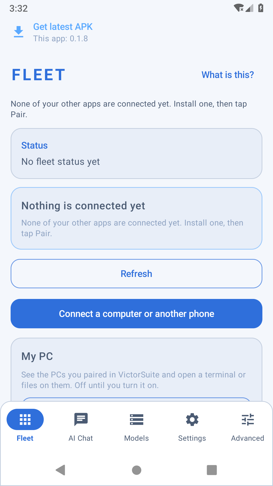
*Fleet: status, Refresh, "Connect a computer or another phone", and My PC. Empty until you pair something.*

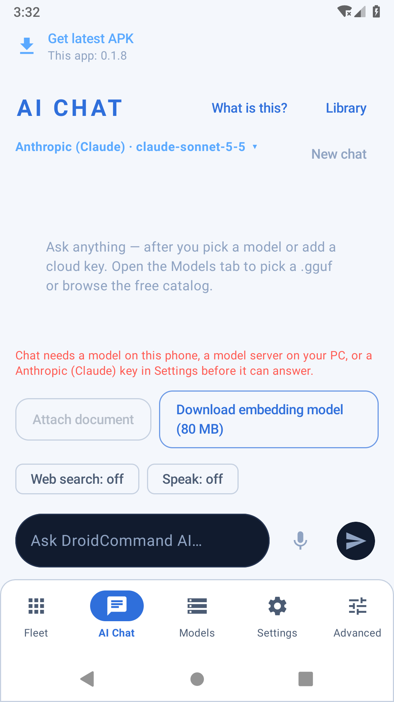
*AI Chat: provider and model at the top, New chat and Library, Attach document, Web search and Speak toggles, the mic, and Send. Until a model or key is set it says so.*

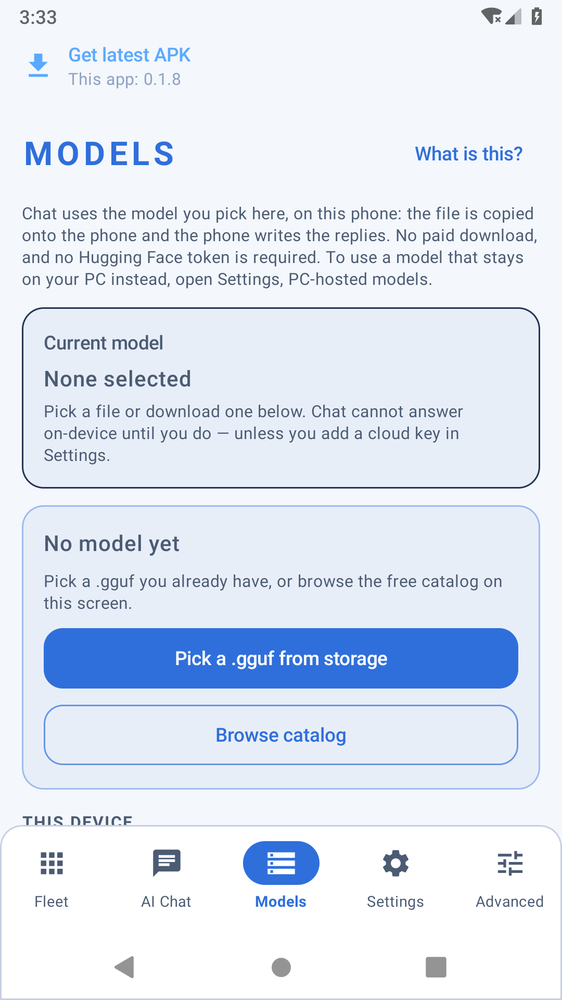
*Models: the current model, "Pick a .gguf from storage", and "Browse catalog".*

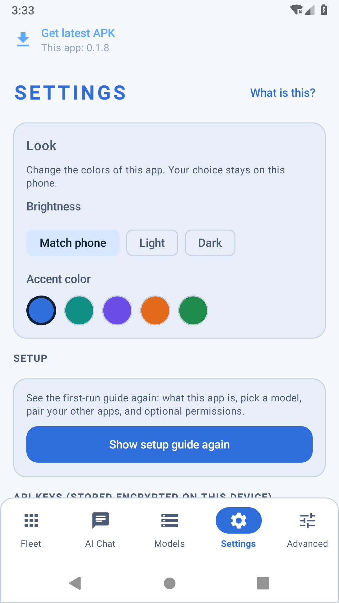
*Settings: Look (brightness and accent colour), Setup, then API keys and the rest below.*

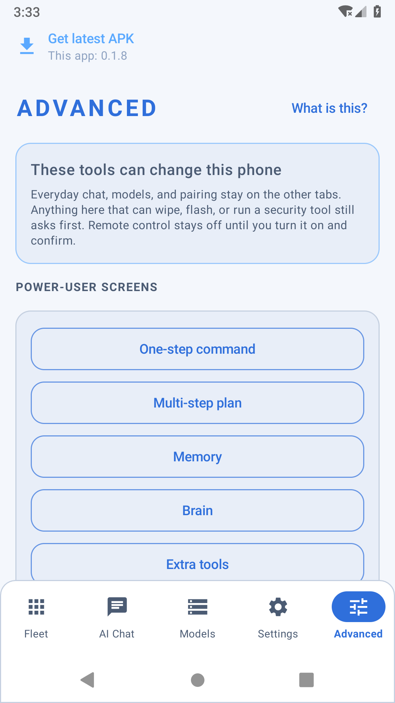
*Advanced: the "These tools can change this phone" note, then the power-user screens (One-step command, Multi-step plan, Memory, Brain, Extra tools, Activity log, Bot maker and more). The Kai capabilities switches and MCP servers are further down.*

**Fleet** lists HackerAI plus the thirteen known Victorious apps. **Pairing** stores that you trust the install that
is on this phone *now*; if that app is later replaced, the connection stops until you pair again. Pairing does not
turn on remote control and does not run a command. Live status from other apps is not wired yet; rows say "no
snapshot yet" until it is.

## 3. AI Chat

- **Provider and model.** The line at the top of Chat picks the cloud provider and model. Or use a model on this
  phone or on your PC ([chapter 4](#4-models-and-keys)). **New chat** starts afresh; **Library** holds your chats,
  skills and templates.
- **Voice.** The mic button transcribes into the chat box (on-device speech-to-text when available). Replies can be
  spoken with the system voice when **Speak** is on. Both stay silent, without crashing, if you deny the permission. Phrases that trigger
  actions are set under Settings → Remote Control and are a *local* trigger, not an inbound command.
- **Web search** is a toggle under the message box ("Web search: off"), **off by default**. It adds search snippets to the question; it is
  not live browsing of arbitrary sites, and needs a search key.
- **Documents.** **Attach document** takes a text or PDF file you can then ask about. It needs a separate embedding-model
  download (the "Download embedding model" button, about 80 MB);
  answers are grounded in the attached text when retrieval is on. PDF text only, no scanned pages.
- **Memory.** "Remember this chat" saves facts into Advanced → Memory. Brain notes are plain Markdown files you can
  also open in other apps.
- **Skills and templates.** A skill adds system text to every message; a template fills the input box.
- **Running a helper bot.** Tap **Run** on a bot in the Bot maker; Chat switches to that bot until you stop it.

## 4. Models and keys

- **On this phone.** A `.gguf` file lets Chat work without a cloud key. Pick a file you already have or download one
  from the catalog (checked against a published SHA-256 before it loads). Some models are large; use Wi-Fi.
- **On your PC.** Settings → PC-hosted models lets Chat talk to Ollama or an OpenAI-compatible server on your PC over your LAN or VPN. This is
  different from importing a `.gguf` onto the phone. See `docs/PC_HOSTED_MODELS.md`.
- **Cloud keys.** Settings holds API keys for Anthropic, OpenAI, Google (Gemini) and Groq. Keys are stored encrypted
  on this phone and never shown again after saving.
- **Where text may go.** The inference policy (this device only / my PC only / prefer PC then device / confirmed
  cloud fallback; default "use the model I pick") decides which places may receive your text. See
  `docs/INFERENCE_POLICY.md`. Bot-to-bot replies follow the same policy.

## 5. Bot maker

A **helper bot** is a saved recipe for one job: a name, instructions, the tools it may use, who it may talk to, and
whether it gets its own Linux sandbox. Bots live only on this phone and run in AI Chat with your usual provider.

**Turn it on first.** Advanced → Kai capabilities → **Bot Maker**. It is off by default.

### The page

The page shows **Your bots** first, each as a card with chips for what it can do (for example "2 tools", "Talks to
Writer", "Sandbox"), and **Run / Edit / Delete**. **New bot** opens one editor with four sections.

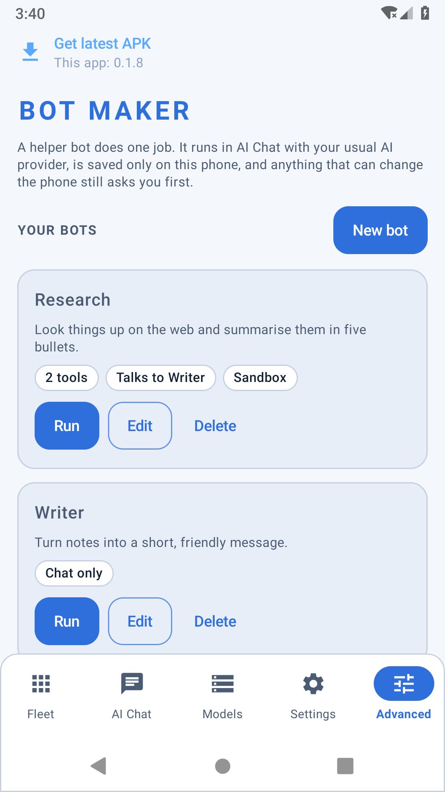
*Your bots, at a glance.*

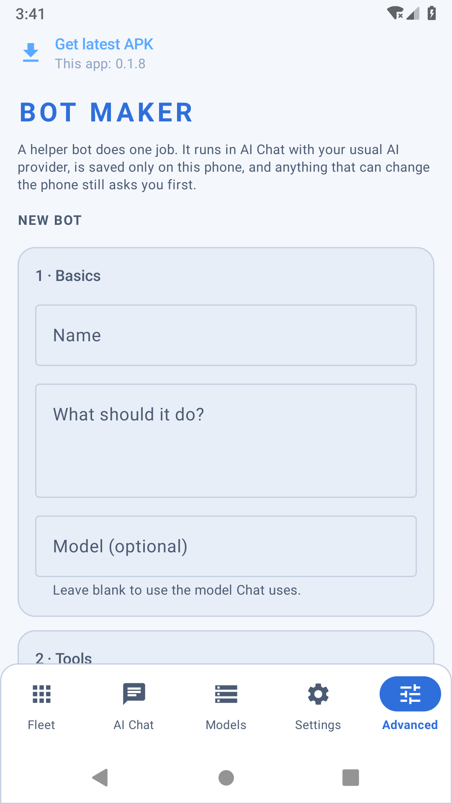
*The editor: 1 · Basics.*

**1 · Basics.** Name, what it should do, and an optional model. A blank model means "the model Chat uses".

**2 · Tools.** Tick what the bot may use. Search by name or description. Tools are grouped by purpose (Terminal &
root, Files, Screen control, Phone, Build, Web & AI, Notes & memory, Fleet & remote…) and **MCP tools are grouped per
server**, with **All / None** for a whole group. Tools marked *asks first* still ask you every time they run. Saving
a bot with tools that can change the phone shows one extra "Allow tools that can change the phone?" check.

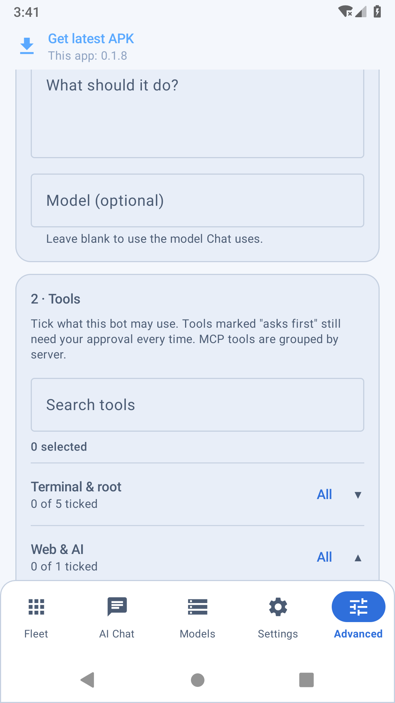
*Tools, grouped. Tap a group to open it.*

**3 · Talks to other bots.** By default a bot can message **nobody**. Tick the bots it may message.

- Permission is **one way**: ticking Writer for Research lets Research message Writer, not Writer message Research.
- The other bot answers **in text only**. It does not run tools while answering, and nothing it says gives the first
  bot any extra permission. The reply is labelled to the receiving bot as "from another helper bot, not the owner".
- Limits that cannot be turned off: a bot already in the conversation cannot be messaged again (no loops), a chain
  is at most three bots long, one conversation allows at most six messages, a message is at most 2,000 characters.
- If a bot asks for someone it is not allowed to message, it gets the same plain answer whether or not that bot
  exists, so it cannot find out which bots you have. The attempt is still logged.
- Deleting a bot also removes it from every other bot's list.

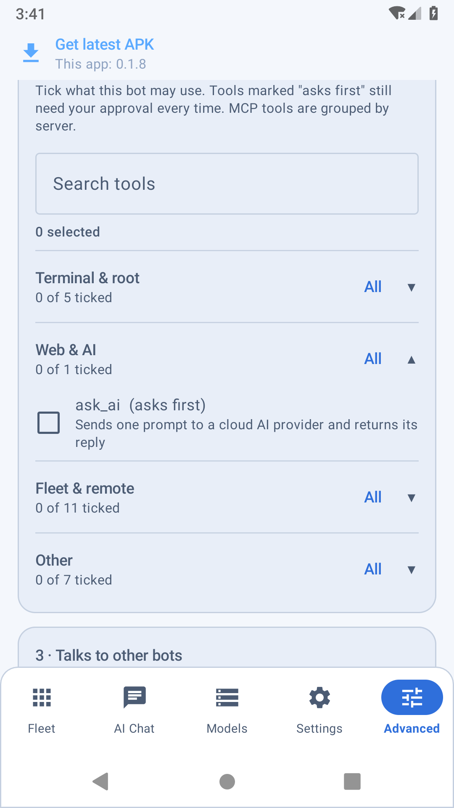
*Who this bot may message.*

**4 · Own sandbox.** Gives the bot its own Linux userland (a separate proot-distro container) in Termux or
VictorSuite, with `sandbox_create`, `sandbox_run` and `sandbox_delete`.

- It needs **two** switches: the bot's own switch here, and **Linux environment** under Advanced → Kai capabilities.
  Both are checked again on every call, so turning either off stops the bot at once, even mid-run.
- It is **not a locked vault.** It is a separate set of files and processes from your Termux home and from other bots'
  sandboxes. It is not a virtual machine, runs as the same Android user as Termux, and can still use the network.
- The first `sandbox_create` downloads a Linux image. **Every** sandbox step asks you first, and every step is
  written to the Activity log.
- **Status: not run on a real phone.** The commands are unit-tested and use only options documented by
  proot-distro, but this has not run against a real proot-distro or a real VictorSuite install. It needs a
  proot-distro version that can install images (older releases used a different install syntax).

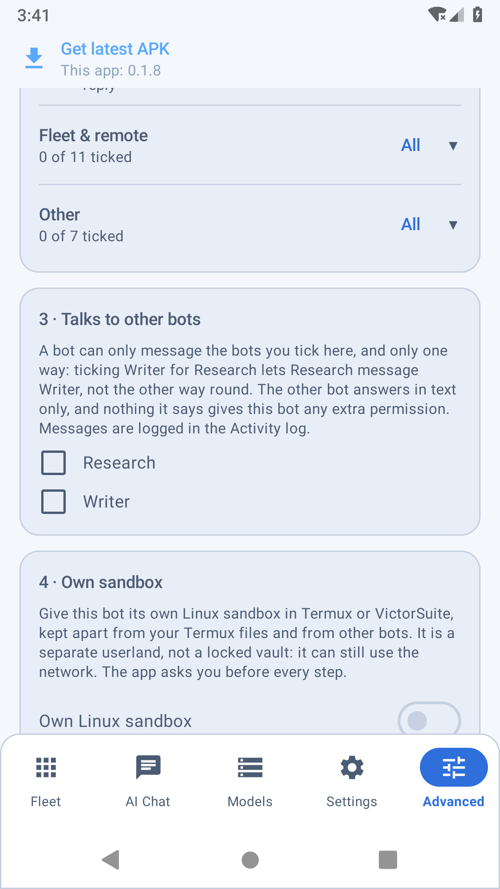
*The sandbox switch, and why it may be disabled.*

### Running a bot

Tap **Run**. Chat shows "Running helper bot …". The bot sees only the tools you ticked (plus its message and sandbox
tools if you switched those on), and the app refuses anything else. It decides *when* to use a tool while it answers;
you decide *whether* each risky call goes ahead, because each one asks you. Tap stop in Chat to end the bot.

Everything a bot does that matters is in **Advanced → Activity log**: tool approvals and denials, bot messages sent
and refused, and sandbox creates, commands and deletes.

## 6. MCP servers (extra AI tools)

MCP lets a bot use tools from a server you run, for example on your home PC.

1. **Turn it on:** Advanced → *Extra AI tools (MCP)* → **Use MCP servers**. It is **off by default**; nothing is
   contacted until you turn it on.
2. **Add a server:** a name, the server address, and an optional token (stored encrypted), then **Add server** and
   **Check servers and load tools**.
3. **Give a bot some of its tools:** in the Bot maker, open the bot's **Tools** section. Each server has its own group
   ("MCP · Home PC"). Tick the tools that bot may use, or tap **All** for that server. Different bots can have
   different servers, and different tools from the same server.

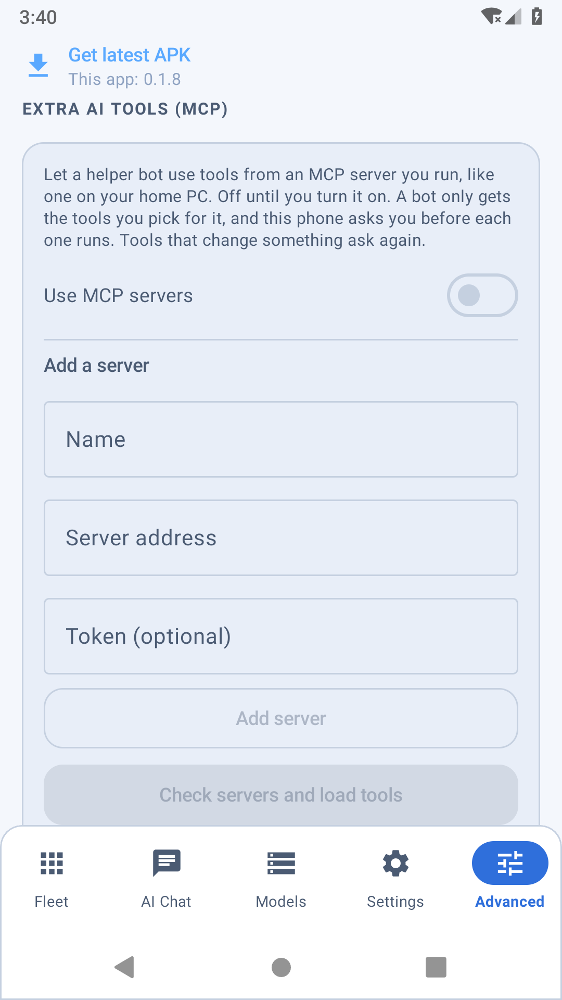
*Advanced → Extra AI tools (MCP).*

Rules that keep this safe:

- A bot can use an MCP tool only while it is **exactly the server entry and remote tool you ticked**. If you remove a
  server, or add a different one with the same name, the tool is not offered and the bot shows "Pick again".
- A bot only gets the tools you pick for it; this phone asks before each call, and tools that change something ask
  again.
- With an on-device model selected, a bot's MCP servers are **not** contacted (an on-device chat makes no network
  request of its own).

**"Whenever they need to."** A running bot chooses when to call the tools it was given. What it cannot do is start
itself: a bot runs when you tap **Run** in Chat. Scheduled or phrase-triggered bots are planned, not built.

## 7. Messages and calls through VictorSMS

**Status: bots cannot send or receive messages or calls through VictorSMS yet.** This chapter says what exists so you
are not left guessing.

What exists today:

- **VictorSMS** (`com.victorious.sms`) is a separate app: Matrix and native SMS messaging, a dialer, call screening, a
  Twilio alias number for texts and calls, and a bridge other Victorious apps can talk to.
- Its bridge can already **queue an SMS** for another app (`sms.send`). Nothing is sent until you tap **Approve** on
  that phone, requests expire, and the bridge is **off until you turn external control on** in VictorSMS.
- Inbound, VictorSMS can **forward** a whitelisted SMS that contains your secret code word to DroidCommand. That is
  only delivery; DroidCommand still decides what, if anything, runs, and never auto-approves a remote trigger.

What does not exist yet: a bot tool that sends a text, reading incoming texts, placing or answering a call, or
reading the call log through the bridge. A bot also cannot hold a live voice conversation: that would need a
real-time speech pipeline that this app does not have.

The plan, when it is built, keeps the same rules as everything else: a per-bot switch (off by default), the VictorSMS
side switch, and an **on-device Approve for every outgoing text and call**.

## 8. Safety: approvals, switches, and the Activity log

- **Approvals.** Anything that can change the phone or reach another app shows a **Confirm action** prompt. Wipe,
  power-off, lock, flashing and security-tool runs always ask. No bot can approve for you.
- **Switches are off by default.** Under Advanced → *Kai capabilities*: MCP client, Linux environment, background
  automation, mailbox, SMS access, cloud transfer, generated UI, skill scripts, Kai Build, Brain, and Bot Maker.
  A bot can never turn one on.
- **Remote control is off** unless you turn it on in Settings, and each paired app has its own switch.
- **Activity log.** Advanced → **Activity log** is an append-only record of security decisions. Denials and refusals
  are shown as problems. If the log is full, the app refuses the action instead of running it unrecorded.

> *Screenshot not captured yet: activity log.*
*The Activity log.*

## 9. Troubleshooting

| You see | Why | What to do |
|---|---|---|
| "Bot Maker is off" | The switch is off by default. | Advanced → Kai capabilities → Bot Maker. |
| The sandbox switch is greyed out | The Linux environment switch is off. | Advanced → Kai capabilities → Linux environment. |
| Bot says "Message not sent: … not allowed" | Its **Talks to** list does not include that bot. | Edit the bot, tick the other bot. |
| Bot says "This conversation has used its 6 messages" | The per-conversation limit. | Start a fresh run. |
| A bot shows "Pick again" | The MCP server it was tied to was removed or changed. | Edit the bot and tick the tool again. |
| MCP tools do not appear | MCP is off, the server is down, or an on-device model is selected. | Turn MCP on, press **Check servers and load tools**, pick a cloud or PC model. |
| Sandbox step fails | Termux or VictorSuite is missing, or its proot-distro is too old. | Install Termux/VictorSuite; update proot-distro. |
| Chat answers "refused by policy" | The inference policy forbids that place. | Change it under Settings, or pick another model. |

## 10. Glossary

- **BYOK** — bring your own key: you supply the cloud API key.
- **Helper bot** — a saved recipe (instructions, tools, peers, sandbox) that runs in Chat.
- **MCP** — Model Context Protocol, a standard for a server to offer tools to an AI.
- **Fleet / node** — your other Victorious apps; a node is one of them.
- **Gate / switch** — an off-by-default setting that must be turned on before a feature works.
- **proot-distro** — a Termux tool that runs a Linux distribution without root.
- **Activity log** — the append-only record of security decisions.

---

# Part 2 — Technical reference

## Pilot, Forge, and tools

- **Pilot** runs one named tool with arguments.
- **Forge** runs a multi-step objective through the planner.

Tools include shell, root, Termux `RUN_COMMAND`, Shizuku, Metasploit,
Social-Engineer Toolkit, web search, and catalog stubs for fleet
members. Every non-read tool goes through `SecureToolExecutor` → an
on-device **ApprovalPrompt**.

### Shizuku

Shizuku / Sui privileged ADB-shell ops (`run_shizuku_command`,
`shizuku_read_device_state`, `shizuku_pm_grant`) never auto-run. Missing
or not-running Shizuku degrades to unprivileged use; it does not crash
or skip confirmation.

### YOLO

YOLO is an explicit opt-in. It may waive **non-destructive** shell /
Termux / Shizuku / root / remote_command the same way it waives ordinary
shell. It **cannot** waive:

- WIPE / POWER_OFF / LOCK / flash / bootloader (`remote_wipe`,
  `remote_power_off`, `remote_lock`, `remote_destructive`)
- Kali / Metasploit / SET / Pentest-Swarm authorization (the phrase
  **I confirm these targets are authorized** and per-step ACTIVE/EXPLOIT
  prompts)

A remote SMS or node trigger **never auto-approves**, even with YOLO.

---

## Fleet control

Tools → Fleet opens the home list of HackerAI plus the **thirteen**
`KnownFleet` members (Pentest, RootForge, VictorSuite, EDL-Commander,
KYC-AuditLab, File Manager, Keyboard, Mesh, Browser, VictorSMS,
VictorSpoof, Victorious Flash, VictorLaunch). Each row shows a short
role, a color for reachable / trouble / down / unknown, and last seen
or “no snapshot yet”. Live status from the phone is **not wired**.
Pair and manage nodes still opens the pairing screen. None is LIVE.

EXTERNAL_NODE rows pair by **package + observed signing cert**. Pairing
is an explicit confirm. A trusted pairing can run read-only Messenger
`capabilities.get` / `status` on some nodes. This app does not auto-bind
companions and never uses DependencyGuard / a shared signing key on
EXTERNAL_NODE members.

Tools → Fleet Orchestrator is a stub overview of node reachability and
last command. Send command still asks first.

---

## Remote control (controller)

DCA is the **sole authorizer**. An inbound command from a fleet node is
an **UNTRUSTED REQUEST**.

VictorSMS (`com.victorious.sms`) is a known `remote.command`
EXTERNAL_NODE ([planned/pending-merge]). Its inbound op is
`sms.remote_command.forward`. It may check a sender whitelist **and** a
secret code word on **its** side. That is **not authorization** — it
only **delivers** the request. DCA owns only the commandId→action
mapping. `trigger.sourceNumber` / `matchedKeyword` / `rawExtras` are
informational. Catalogued SMS ops are isolated from destructive paths
(a forwarded wipe commandId is still classified independently). Debug
cert is documented (alias `androiddebugkey`) but **not pinned yet**
(fail-open); release cert TBD.

The controller then re-applies, in order:

1. Caller-id = package + cert pairing of the source node
2. External-control switch (**OFF by default**) on **both** node ops and
   the controller inbound surface
3. Envelope / replay check (top-level `nonce` / `timestampMs` / `ttlMs`)
4. The controller's own policy gates (mapping exists, independent
   classification, ApprovalPrompt)

Destructive ops (wipe, power-off, lock, flash, bootloader) always stay
behind device-admin / root / Shizuku **and** explicit on-device
approval. A remote trigger **never auto-approves** and **never
auto-sends** on behalf of a remote caller.

Controller inbound action (named, not exported in this skeleton):
`ai.droidcommand.app.action.BRIDGE`, op `remote.command`.

### Frozen envelope (top-level v1)

Anti-replay fields are **top-level** (not nested under `auth`):

`nonce` (128-bit unique), `timestampMs` (epoch ms), `ttlMs`.

Plus `requestId` (the existing BridgeRequest `request_id`),
`targetNodeRef`, `actionRef`, `args`, advisory `destructive`.

`trigger.sourceNumber` / `matchedKeyword` / `rawExtras` are
informational only. A self-reported number cannot authorize anything.

Replay: seen-nonce cache keyed by `(sourceNodeRef, nonce)`. Duplicate
pair → `replay_detected`. Past `timestampMs + ttlMs` → `expired`. A
timestamp more than 120s in the **future** → `expired`. The 120s window
is future-skew only; past validity is TTL-only (full 300s max TTL is
usable).

`targetNodeRef` errors: blank/malformed → `invalid_parameters`; unknown →
`not_found`; known but unpaired → `not_paired`. Envelope fields inside
`parameters` are camelCase; the outer BridgeRequest wrapper is
snake_case.

### Generic command surface

Every fleet APK advertises:

- `capabilities.get` — protocol minor 1 + per-op descriptors
  `{ name, kind: read|action|destructive, remoteAllowed, requiresConfirm }`
- `macro.step` `{ op, params }`
- `macro.run` `{ steps: [{ op, params, onError, timeoutMs }], dryRun }`
- `node.status.get` — frozen STATUS-TRAY snapshot (`docs/specs/STATUS_TRAY.md`).
  Standalone BridgeRequest `operation`, not a `remote.command` `actionRef`.
- `config.export` / `config.import` — frozen SETTINGS/BACKUP bundle
  (`docs/specs/UNIFIED_BACKUP.md`). Standalone ops, not `remote.command`
  `actionRef`s. Off the remote surface by default.

The node runner dispatches **only** to its own advertised ops, sequentially.
`onError: abort` (atomic) stops on first error and reports **partial**
results — it does **not** roll back. `dryRun` validates params + gates
without executing.

### Four trigger types

1. **SMS** — VictorSMS delivers `sms.remote_command.forward` after its own gates.
2. **Voice** — exact phrase in Settings → Remote Control.
3. **Schedule** — stored expression only; live scheduler is a stub.
4. **Manual** — Run on a mapping or macro (still asks first).

### Macros bot

Settings → Remote Control → Macros names an ordered list of fleet
steps and binds one of the four triggers. Dry-run validates. Run still
opens the approval dialog, then the stub fails. Any independently
classified destructive step requires approval at run.

---

## Status tray

Settings → Remote Control → Status tray consumes **and** publishes last
health rows per node (mesh / VPN / browser / SMS / node health). Shared
with VictorLaunch. The snapshot schema is frozen in
`docs/specs/STATUS_TRAY.md` (`node.status.get`). This app still uses an
in-memory aggregate. No live bind.

---

## Backup / restore

Settings → Remote Control → Local backup exports a **versioned JSON** of
this controller's **macros, mappings, and device pairings** (plus
targets and last status-tray rows) to a file on this device. That JSON
is one entry in the frozen cross-app bundle
(`docs/specs/UNIFIED_BACKUP.md`). API keys, signing keys, passwords,
and VictorSMS secrets are **not** included. Restore never turns
external control / `remote.command` back on by itself. No live bind.

---

## VictorSpoof

VictorSpoof (`com.victorious.spoof`) is a known EXTERNAL_NODE (novelty /
prank caller-ID). It is a remote.command **target**, isolated from
wipe / power-off / lock / flash / bootloader. Signing certs are not
pinned yet (fail-open). TODO: pin later.

---

## KYC-AuditLab companion

KYC-AuditLab's companion APK (`com.identityshield.companion`) is a
`remote.command` EXTERNAL_NODE **[provisional/pending-stable-cert]**. The
**active** debug SHA-256 (`6F:46:77:…:2D:4D`) is from a **per-machine
default debug.keystore** and is **not stable across machines** —
documented, **not enforced** (fail-open). The **pending permanent** debug
SHA-256 (`22:4F:C1:…:44:1D`) is from KYC's **committed debug keystore**
(reproducible) in **KYC PR #29**, which is **not merged yet** — recorded,
**not enforced**. Swap the active pin once #29 merges. Do not enforce
either. `remote.command` is **OFF by default**. All PII ops are
`remoteAllowed:false`; the controller never remote-allows them either.
Isolated from wipe / power-off / lock / flash / bootloader. The localhost
IdentityShield simulator stays a host-process slot; the hub must not
call `/scope` admin.

---

## Approval gates (summary)

| Action | Gate |
|---|---|
| Cloud chat | BYOK key in the vault |
| Shell / Termux / Shizuku / root | ApprovalPrompt; YOLO may waive |
| Kali / pentest / Metasploit / SET | Phrase + per-step prompts; YOLO cannot waive |
| Remote wipe / power-off / lock / flash / bootloader | Device-admin/root/Shizuku **and** ApprovalPrompt; remote never auto-approves; YOLO cannot waive |
| Remote non-destructive command | ApprovalPrompt; YOLO may waive like shell |
| Inbound node command | Pairing, then external-control OFF-default, then replay, then policy |

Help in the app is this manual. The live privileged buttons still fail
closed after they ask.
