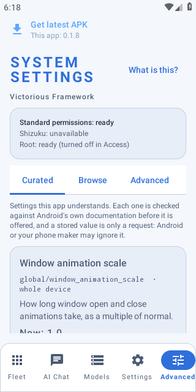
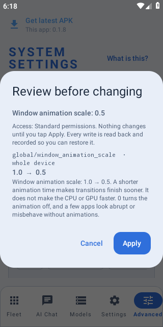
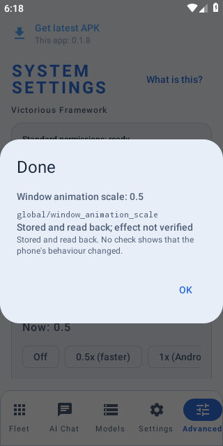
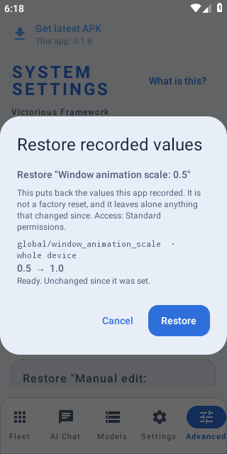

# System Settings (Victorious Framework)

A native editor for Android's **System**, **Secure** and **Global** settings tables, inside DroidCommand AI (Advanced → *System Settings*).
It is an independent implementation. The idea of a SetEditPlus-style settings editor was inspired by
[kerneldroid/SetEditPlus](https://github.com/kerneldroid/SetEditPlus) (MIT, © 2026 kerneldroid). **No source code from it is copied here**, so no
reuse attribution is required; this note is the credit. Work attribution: Victorious.

> **Honesty box.** The engine has 91 JVM tests, and the screen and the edit → readback → history → restore → readback flow ran on **one Android 9 (API 28)
> emulator** in CI. Nothing has been run on a physical phone, on any other Android version, or against a live Shizuku or root. See *What was and was
> not verified* at the end and the 2026-11-15 audit addendum.

## Screenshots (real, from the CI emulator run; 320×640, Android 9)

| Curated | Preview before changing | After the change | Restore preview |
|---|---|---|---|
|  |  |  |  |

More in `docs/images/system-settings/` (Modified, History, Browse, Advanced with an unknown key, Profiles, Access).

## What it does

| Tab | What you get |
|---|---|
| **Curated** | Settings the app understands, with a plain-language explanation, the accepted range, what a stored value does and does not prove, and where each fact was checked. One-tap presets and a custom value. A combined **Private DNS** card. |
| **Browse** | Every row of the System, Secure or Global table, searchable. Unknown rows are labelled *unknown*; the app never guesses what they do. High-impact values are masked until you tap Show. |
| **Advanced** | Add, edit or remove any entry by name. Unknown entries need an explicit "I reviewed this" tick. High-impact entries need a second confirmation. |
| **Modified** | Entries this app changed, with the original value recorded before the first change, and one-tap restore (single entry or all). |
| **History** | Every change and restore, newest first, with backend, source and per-entry outcome. |
| **Profiles** | Starter and custom profiles, JSON import/export, and optional reapply-after-reboot. |
| **Access** | Which access methods are ready, what each can write, what you allow, and exact setup commands for this phone. |

Absent, empty-string, unreadable, unsupported and permission-denied are **different states** and are shown differently.

## Access setup

The app picks the **least privileged** method that can do the job, in this order, and never moves up by itself:

1. **Standard permissions** (ContentResolver / `Settings.*`). Reads need nothing. Writes need:
   - Secure and Global: `WRITE_SECURE_SETTINGS`, granted once from a computer:
     `adb shell pm grant ai.droidcommand.app android.permission.WRITE_SECURE_SETTINGS`
   - System: the *Modify system settings* special access (Settings → Apps → Special app access), or
     `adb shell appops set ai.droidcommand.app WRITE_SETTINGS allow`
   Only the user the app runs as is reachable this way.
2. **Shizuku** (built-in or the Shizuku app). Runs the `settings` shell command as the shell user. Reaches all three tables and, if you allow it,
   other users.
3. **Root** (`su`). **Off until you turn it on in Access.** A rooted phone is not enough on its own. Your root manager still decides each request.

If a method fails at run time (permission revoked, Shizuku stopped, timeout), the change stops and reports why. It does **not** retry on a higher tier.
The Access tab prints the same commands with your real application id and Android version.

There is no remote settings command in this app, so remote requests are refused (see *Assistant and remote*).

## Making a change

1. Pick a value (preset, custom, profile, or Advanced). You get a **preview**: table, scope (whole device or user N), old value, new value, the
   access method, and notes. Blockers and warnings are listed.
2. Confirm. The app **rebuilds the plan at that moment**; if the phone changed after the preview it refuses and shows the new preview.
3. Before the first write, a durable record is saved: the exact previous state (including whether the entry existed), the proposed change, table
   and scope. If the record cannot be saved, nothing is changed. If the previous value cannot be read, or cannot be captured exactly (multi-line or
   control characters), the entry is not changed.
4. Each write is **read back**. The result is one of: *permission failure*, *Android rejected the value*, *read back a different value*, *stored and
   read back; effect not verified*, or *stored, read back, effect verified*. Only Private DNS has an independent effect check (is encrypted DNS in
   use on the active network). Refresh rate shows the rate the display is running, which is not the stored preference.
5. Several entries are applied one by one in a deliberate order (for Private DNS the hostname goes in before `hostname` mode, and the mode goes out
   before the hostname is touched). If one fails, the earlier ones are put back newest first. **This is not a database transaction**; if a put-back
   fails or the value was changed by something else meanwhile, it is left alone and reported as a partial failure.
6. Only one settings operation runs at a time. A second request gets "busy" and writes nothing.
7. If the app is killed mid-change, the next start only **reads** the phone and records what it found. It never replays a write.

## Restoring

* *Restore this change* puts back the previous value of that operation. *Restore original* puts back the value recorded before the **first** change
  this app ever made to the entry (the baseline), even after several intermediate changes. Both are kept in History.
* The current value is read first. If it is not what this app last wrote (Android, another app, or a later change moved it) the entry shows a
  **conflict** and is left alone. You can choose to overwrite a specific conflict.
* An entry is **deleted** only when its record proves it did not exist before. An entry that was the empty string is written back as the empty string.
* Bulk restore shows a preview first. Restoring recorded values is **not** an OEM factory reset.

## Included settings

Only settings whose key, type and meaning were read in the Android framework source are included. Each card lists its source and notes.

| Setting | Table | Notes |
|---|---|---|
| `window_animation_scale`, `transition_animation_scale`, `animator_duration_scale` | Global | Float; 0 disables. 0, 0.5, 1 presets. The 0–10 cap is this app's own safety bound; Android documents no maximum. Shorter animations finish sooner; they do not speed up the CPU or GPU. |
| `screen_off_timeout` | System | Milliseconds. May be capped by a device policy. 5 s–1 h is this app's bound. |
| `screen_brightness_mode`, `screen_brightness` | System | Mode 0/1. Level 1–255 (older docs say 0–255, current says 1–255). OEMs often map this nonlinearly. |
| `accelerometer_rotation`, `user_rotation` | System | 0/1 and 0–3. `user_rotation` only applies while auto-rotate is off. |
| `min_refresh_rate`, `peak_refresh_rate` | System | Hidden platform keys, present in Android 12+ (absent in the Android 9 source; 10 and 11 not checked). Choices come from the rates the display reports; hidden when it reports only one. Many OEMs use other keys, so this may do nothing visible. |
| `stay_on_while_plugged_in` | Global | Bit set: 1 AC, 2 USB, 4 wireless, 8 dock (dock bit only from API 34; releases between were not checked). |
| `private_dns_mode`, `private_dns_specifier` | Global | `off` / `opportunistic` / `hostname`, and a hostname. Changed together; the previous provider is recorded and restored exactly. Mode strings were read from the Android 9 source. |

**Deliberately not included:** FPS, RAM expansion, overclocking, thermal-disable and battery-boost "presets". Where direct editing is not
supported, use the phone's ordinary Settings screens.

## Profiles

* **Starter**: *Quick UI* (0.5x animations), *App Testing* (10 minute timeout, optional keep-awake while charging), *Battery-conscious Display*
  (60 Hz cap, 30 s timeout, automatic brightness; the tradeoffs are printed and no battery saving is claimed).
* **Custom**: *Save current values* picks supported settings and stores their current values. Saving never applies anything.
* **Apply** shows the exact changes and lists **unsupported** entries (for example a refresh rate the display lacks) before anything runs.
* **JSON** (`victorious-system-settings-profile`, version 1) via the system document picker. Import is strict: size ≤ 64 KiB, ≤ 32 entries, no
  unknown fields, valid tables/scope/types, no duplicates, no shell fragments in any string, only reviewed settings. A fresh local id is assigned, so
  an import cannot overwrite an existing profile. A profile from another phone is re-checked against *this* phone when applied.
* Identity, credential, provisioning, accessibility-service and input-method settings can never be in a profile or an unattended replay.

## Reapply after reboot

Off by default and set **per profile**. Enabling it records the firmware and Android version you reviewed. At boot (after the first unlock, so the
encrypted history is readable) it:

* runs each enabled profile at most twice per boot, counting the attempt before it starts;
* never loops, never starts or elevates a backend, never regrants a permission;
* shows **pending** if no allowed access method is ready, and tries again only at the next boot;
* does **not** move your recorded original baseline;
* **suspends** after three failures in a row, or when the build fingerprint, Android version or profile contents differ from what you reviewed, until
  you turn it off and on again.

Standard permissions work immediately at boot. Shizuku usually is not running yet, so a profile that needs it will often show *pending*.

## Assistant and remote

* The assistant has two tools, `system_settings_read` and `system_settings_change`. Both refuse unless you turn on **Access → Let the assistant use
  System Settings** (default off). Reads share only **reviewed settings**: never raw tables, identifiers, or unknown/high-impact values. Changes cover
  reviewed settings only, stored values only (no removal), and ask you through the normal approval prompt with the old and new values **at execution
  time**, even if a grant or YOLO mode exists. Suggestions and imported data are never applied automatically.
* Which model receives what a tool returns is still decided by your inference policy (`docs/INFERENCE_POLICY.md`); these tools add no network path.
* **Remote:** there is no remote settings command or `REMOTE_SETTINGS` permission in this app, and none was invented. The engine refuses
  remote-sourced requests unless a `RemoteSettingsAuthorizer` is supplied (it must check pairing, device scope and the settings permission), and
  even then the owner is asked. The tool specs also exclude the remote initiator, so MCP/remote callers are refused by the secure executor.

## Common errors and recovery

| You see | Meaning | Do this |
|---|---|---|
| *Permission failure* | The access method lacks the Android permission. | Access tab → run the shown `adb` command, or start Shizuku. |
| *Android rejected the value* | The provider did not store it. | Use a documented value; check Details on the card. |
| *Read back a different value* | Stored, but not what you asked (the provider or OEM changed it). | The earlier values were put back; try another value or leave it. |
| *Stored and read back; effect not verified* | The value is in the table. The app cannot show the phone behaves differently. | Check on the phone; do not assume the effect. |
| *Cannot list this table* | Android will not enumerate it for an app. | Read via Shizuku/root, or look up one entry by name in Advanced. |
| *Conflict* on restore | The value changed after this app set it. | Review; tick *Overwrite anyway* only if you want the recorded value back. |
| *Access method unavailable* | Shizuku stopped, device disconnected, or root not allowed. | Fix it in Access; nothing was retried on another method. |
| *Busy* | Another settings operation is running. | Wait and retry. |
| *Suspended* (reapply) | Repeated failures or a changed firmware/profile. | Review the profile, then turn reapply off and on. |

## Privacy

Settings, history and profiles stay on the phone. Nothing is sent to a model or any service automatically. An export is a file you choose where to
save, and it never contains the reapply switch.

## What was and was not verified

* **Ran:** 91 JVM tests; `testDebugUnitTest` + ktlint on all Android modules; an arm64 debug APK build; and three instrumented tests on an API 28 emulator
  (all tabs; edit/readback/history/restore/readback of `window_animation_scale` with independent `adb shell settings get` checks; add and restore-by-deleting
  of an absent Global key).
* **Did not run:** any physical phone; Android 10+ behaviour; OEM keys; live Shizuku or root; Private DNS, refresh-rate and charging changes on a device;
  reboot reapply; the document picker; TalkBack.

See the 2026-11-15 addendum in `docs/AUDIT_2026-09-05.md` for exact commands, results and the full list.
