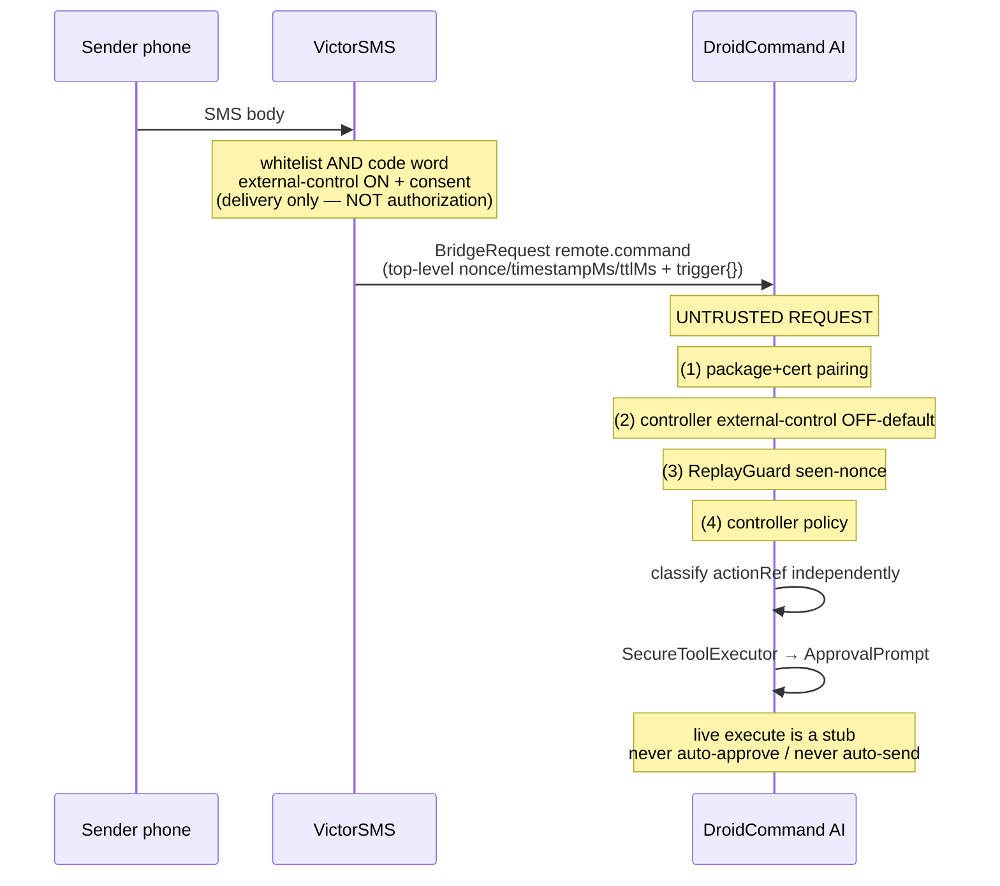
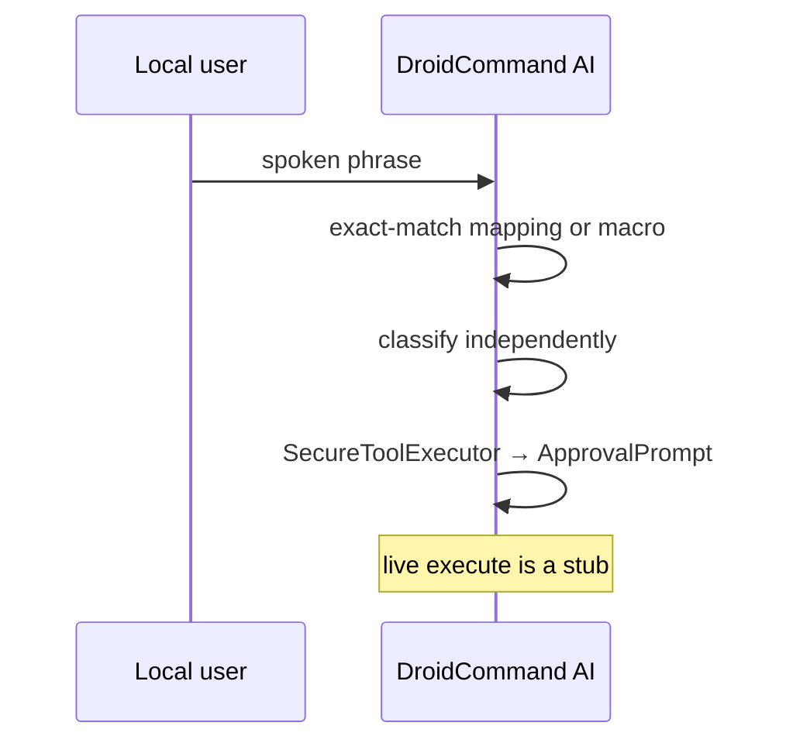

# Remote Control — fleet envelope (FROZEN v1)

Status: **SKELETON**. Spec + JVM data model + Settings UI only.

**Protocol status:** FROZEN by the Fleet Orchestrator (this document).
**Top-level fields won.** A nested `auth` object was considered and is
**superseded**. Major stays `BRIDGE_PROTOCOL_MAJOR = 1`. Minor is
`BRIDGE_PROTOCOL_MINOR = 1`, advertised in `capabilities.get`. Do **not**
add a required `protocol_minor` field on `BridgeRequest` (that would break
existing nodes).

**Phase boundary (this PR):** frozen top-level envelope codec (`nonce` /
`timestampMs` / `ttlMs` / `destructive` at the top of `parameters`), three
controller-side transport bindings, ReplayGuard keyed by
`(sourceNodeRef, nonce)`, generic command surface (`capabilities.get` /
`macro.run` / `macro.step` + op descriptors), inbound controller bridge
action, trust pipeline, error categories, mapping/macros model, Settings
skeleton, approval-gated tool names. **No live privileged execution.** No
real wipe, power-off, lock, flash, bootloader, RustDesk, Messenger bind,
AIDL command, or Termux privileged action. Seams return "not implemented"
after `SecureToolExecutor` → `ApprovalPrompt`. A remote trigger **never**
auto-approves and **never** auto-sends on behalf of a remote caller.

Honesty: **ON DISK / UNVERIFIED**.

DroidCommand AI is the **controller / sole authorizer**. It commands every
fleet APK via direct AI control and via macros, across `EXTERNAL_NODE`,
`BOUND_COMPANION`, and `TERMUX_IPC`. An inbound node→controller command is
an **untrusted request**.

---

## Phase boundary

| In this PR | Not in this PR |
|---|---|
| Spec, JVM model, unit tests, Settings skeleton | Live privileged execution |
| Top-level envelope codec (`nonce` / `timestampMs` / `ttlMs` / `destructive`) | Live Messenger / AIDL / RUN_COMMAND send |
| ReplayGuard seen-nonce cache keyed by `(sourceNodeRef, nonce)` | VictorSMS / VictorSpoof / KYC companion cert pins (unpinned / fail-open) |
| Advisory `destructive` ignored for gating | Changing Kali / pentest / YOLO pentest gates |
| Generic `capabilities.get` + `OpDescriptor` | Live node capability bind |
| Frozen STATUS-TRAY schema (`node.status.get`) | Live status pull / VictorLaunch bind |
| Node `macro.run` / `macro.step` runner (sequential, partial, no rollback) | Live macro execution / scheduler |
| Trust pipeline (pairing → external-control OFF → replay → policy) | Exported controller BRIDGE receiver |
| Error category enum | Auto-approve / auto-send for a remote caller |
| Status-tray consume+publish (generic model) | Live Messenger / AIDL / Termux bind |
| Frozen SETTINGS/BACKUP bundle (`config.export` / `config.import`) | Live cloud upload / on-device Keystore wrap / live bind |
| VictorSpoof `KnownFleet` row (isolated from destructive) | VictorSpoof cert pins / live spoof |
| KYC companion `remote.command` registry row (`[provisional/pending-stable-cert]`, fail-open; PII `remoteAllowed:false`) | Stable KYC companion cert pin / live KYC remote |
| `docs/MANUAL.md` + in-app Help | — |

---

## TRUST MODEL (critical)

**An inbound command is an UNTRUSTED REQUEST.**

A whitelisted SMS sender + code word (VictorSMS's **own** check) is
**not** authorization — it only **delivers** the request to the
controller. The controller is the **sole authorizer and executor**.

The dispatcher re-applies, **in this order**:

1. **Caller-id** = package + cert pairing of the source node
   (`Message.sendingUid` / Binder uid + signature permission /
   Termux `RUN_COMMAND` permission + allow-list). Never a payload field.
2. **External-control switch** — **OFF by default**. Enforced on **both**
   node ops and the controller's inbound surface.
3. **Envelope / replay check** (top-level `nonce` / `timestampMs` /
   `ttlMs` + seen-nonce cache keyed by `(sourceNodeRef, nonce)`).
4. **The controller's own policy gates** (mapping/macro exists, independent
   `actionRef` classification, `SecureToolExecutor` → `ApprovalPrompt`).

Destructive ops (**wipe, power-off, lock, flash, bootloader**) **always**
stay behind device-admin / root / Shizuku **and** explicit on-device
approval. A remote trigger **never auto-approves**. The controller
**never auto-sends** on behalf of a remote caller.

`trigger.sourceNumber` / `matchedKeyword` / `rawExtras` are telemetry
only. Envelope `destructive` is **advisory only** — the receiver
classifies `actionRef` independently.

---

## 1. One logical contract

One field set, one op set, one replay rule, one gating rule. Three
encodings (appendices A–C). **Do not invent per-class field names.**

### Ops (generic command surface — every fleet APK)

| Op | Meaning |
|---|---|
| `capabilities.get` | Advertise protocol **minor 1** (major stays 1) plus per-op descriptors. |
| `remote.command` | One action on `targetNodeRef`. Controller inbound op. |
| `macro.step` | `{ op, params }` — one advertised op on **this** node. |
| `macro.run` | `{ steps: [{ op, params, onError, timeoutMs }], dryRun }` on **this** node. |
| `node.status.get` | Frozen STATUS-TRAY snapshot. Canonical spec: [`docs/specs/STATUS_TRAY.md`](STATUS_TRAY.md). |
| `config.export` / `config.import` | Frozen SETTINGS/BACKUP bundle. Canonical spec: [`docs/specs/UNIFIED_BACKUP.md`](UNIFIED_BACKUP.md). |

Outer framing is still BridgeRequest / BridgeResponse
(`protocol_major` 1, `Message.what` 1 request / 2 response, action
`<pkg>.action.BRIDGE`).

Controller inbound (NEW direction; the historical standard was
controller→node only):

- Action: `ai.droidcommand.app.action.BRIDGE`
- Op: `remote.command`
- This skeleton **does not** export a live Messenger receiver.

### `capabilities.get` result

```json
{
  "protocolMajor": 1,
  "protocolMinor": 1,
  "ops": [
    {
      "name": "capabilities.get",
      "kind": "read",
      "remoteAllowed": true,
      "requiresConfirm": false
    }
  ]
}
```

Per-op descriptor: `{ name, kind: read|action|destructive, remoteAllowed:
Boolean, requiresConfirm: Boolean }`.

### Frozen top-level fields (v1)

**ALL of these are TOP-LEVEL** (not nested under `auth`). Wire/model
field name for issued-at is **`timestampMs`**, not `issuedAt`.

| Field | Type | Notes |
|---|---|---|
| `requestId` | string | **The existing BridgeRequest `request_id`.** Reuse it. Do **not** add a second id. Correlates the response. Not repeated inside `parameters`. |
| `targetNodeRef` | string | Destination node id or the literal `controller` for inbound. |
| `actionRef` | string | Op to run on the target (e.g. `scan.run`, or a controller mapping id). |
| `args` | object | Default `{}`. |
| `nonce` | string | 128-bit unique (hex 32 chars, or equivalent base64). |
| `timestampMs` | number | Epoch ms (`Long`). Wire/model name is `timestampMs`, **not** `issuedAt`. |
| `ttlMs` | number | Default `120000`. Max `300000`. |
| `destructive` | bool | **ADVISORY ONLY.** Never used to authorize. |

### Casing

Two JSON casings, on purpose. Nodes must not mix them.

**Envelope fields** (inside `parameters`, the TERMUX_IPC JSON blob, and
the BOUND_COMPANION field map) are **camelCase**: `targetNodeRef`,
`actionRef`, `args`, `nonce`, `timestampMs`, `ttlMs`, `destructive`,
`trigger`.

**Outer BridgeRequest / BridgeResponse** wrappers are **snake_case**:
`protocol_major`, `protocol_minor` (optional; **not** required on
`BridgeRequest`), `request_id`, `target_node_id`, `operation`,
`timeout_ms`, `parameters`.

`requestId` is the logical field; on EXTERNAL_NODE it **is** the outer
`request_id` and is **not** repeated inside `parameters`.

`macro.step` / `macro.run` keep their existing step fields; they use the
same top-level anti-replay fields (do **not** nest them).

`macro.step` (generic node surface):

| Field | Type | Notes |
|---|---|---|
| `op` | string | Must be an advertised op on **this** node. |
| `params` | object | Default `{}`. |

`macro.run` (generic node surface):

| Field | Type | Notes |
|---|---|---|
| `steps` | array | `{ op, params, onError: "abort"\|"continue", timeoutMs }`. |
| `dryRun` | bool | Validate params + gates **without executing**. |

**Node macro runner:** dispatches **only** to that node's advertised ops,
runs steps **sequentially**, returns per-step results. **`atomic`** =
stop-on-first-error (`onError: "abort"`) **and report partial**. Do
**not** promise rollback. `onError: "continue"` keeps going.

Controller Settings macros (voice / SMS / schedule / manual spanning
nodes) still exist above this surface; they are not a second wire
contract.

### Authorization identity (prominent)

**Source identity for authorization is package + cert (`Message.sendingUid`
on Messenger; Binder caller uid + signature permission on AIDL;
`com.termux.permission.RUN_COMMAND` + allow-list on Termux).**

**Never authorize from a payload field.** A self-reported phone number,
keyword flag, or `destructive:false` cannot grant anything.

VictorSMS may attach an informational sub-object:

```json
"trigger": {
  "sourceNumber": "+15555550100",
  "matchedKeyword": true,
  "rawExtras": {}
}
```

VictorSMS still owns whitelist + code word + its own external-control
switch (OFF by default) + consent **on its side**. Those checks only
**deliver** the request. DCA owns pairing, the controller external-control
switch, replay, and `actionRef` → mapping/macro.

### Example (`remote.command` inbound to the controller)

Outer BridgeRequest (`request_id` is `requestId`):

```json
{
  "protocol_major": 1,
  "request_id": "6f1a9c2e-3b84-4d91-9e0a-11a0c84d0001",
  "target_node_id": "controller",
  "operation": "remote.command",
  "timeout_ms": 120000,
  "parameters": {
    "targetNodeRef": "controller",
    "actionRef": "lock-tablet",
    "args": {},
    "nonce": "aaaaaaaaaaaaaaaaaaaaaaaaaaaaaaaa",
    "timestampMs": 1760920000000,
    "ttlMs": 120000,
    "destructive": false,
    "trigger": {
      "sourceNumber": "+15555550100",
      "matchedKeyword": true,
      "rawExtras": {}
    }
  }
}
```

`requestId` is **not** duplicated inside `parameters`. `nonce` /
`timestampMs` / `ttlMs` / `destructive` **are** top-level parameter
fields. VictorSMS `sourceNumber` / `matchedKeyword` / `rawExtras` stay
in informational `trigger:{}` — **never** part of auth. Source identity
= package+cert (`sendingUid`).

### SMS flow



### Voice flow



Local voice / manual Run are **not** inbound node commands; they still
never auto-approve destructive work.

---

## 2. Replay

Controller keeps a **seen-nonce cache keyed by `(sourceNodeRef, nonce)`**
for the TTL window (retention ≥ 10 minutes, ≥ max `ttlMs`). The same
nonce from a different source is a distinct key.

Reject:

| Condition | Code |
|---|---|
| seen `(sourceNodeRef, nonce)` | `replay_detected` |
| `now > timestampMs + ttlMs` | `expired` |
| `timestampMs > now + 120000` | `expired` (future skew only) |

The 120s window is a **future-skew allowance only**, not a two-sided
cap. Past validity is TTL-only, so the full 300s max TTL is usable. A
request with `timestampMs = now - 200000` and `ttlMs = 300000` is still
valid. Do **not** apply `|now - timestampMs| > 120000`.

In-memory in this skeleton (lost on process death). Not a MAC.

---

## 3. Error categories (RATIFIED)

Extend `{ invalid_parameters, not_paired, not_found, internal }` with:

`unauthorized`, `replay_detected`, `expired`,
`external_control_disabled`, `confirmation_required`, `unsupported_op`,
`capability_off`.

Modeled as `RemoteErrorCategory` in `core-remotecontrol`.

### `targetNodeRef` errors

Destination resolution for envelope `targetNodeRef` (not source identity):

| Condition | Code |
|---|---|
| blank / malformed | `invalid_parameters` |
| unknown / unresolvable | `not_found` |
| known (catalog id, package, stored target, or well-formed prefix such as `victorsms-<32 hex>`) but unpaired | `not_paired` |

The literal `controller` is always resolvable (the hub itself) and does
not need a `DevicePairing` row. Source pairing is a separate, earlier
trust-pipeline check.

---

## 4. Destructive flag is advisory

The **receiver independently classifies `actionRef`** (mapping, macro
step, or `RemoteAction` table) and enforces
`SecureToolExecutor` → `ApprovalPrompt` (device-admin / root / Shizuku
+ on-device confirm).

The dispatcher **ignores `destructive` for the gating decision**. It may
use the flag for UX, telemetry, or defense-in-depth copy only.

A forged `destructive: false` on a wipe/power-off/lock `actionRef` must
still be classified destructive and never auto-approved (including YOLO).
Covered by unit test.

WIPE / POWER_OFF / LOCK / custom-destructive / any macro that contains a
destructive step use `remote_wipe` / `remote_power_off` / `remote_lock` /
`remote_destructive`. Those names sit in
`YoloMode.DESTRUCTIVE_REMOTE_NAME_TOKENS`, a **separate** set from
Kali/pentest tokens. YOLO may waive non-destructive `remote_command` /
`remote_screen_control` / `remote_macro` like shell. Kali/pentest
ACTIVE/EXPLOIT gates and `I confirm these targets are authorized` are
**untouched**. Token `lock` is not used (would match clipboard tools).

---

## 5. Mappings, targets, macros, pairings

Controller Settings store **command mappings, target devices, macros,
device pairings, and the external-control switch (OFF by default)**.
They do **not** store VictorSMS whitelist or code word.

```
RemoteCommandMapping  id, displayName, voicePhrase?, smsCommandId?,
                      targetNodeId, action, deliveryMode, destructive
TargetDevice          nodeId, displayName, integrationClass, packageName?
DevicePairing         sourceNodeRef, packageName, certSha256?
Macro                 id, displayName, steps[], trigger
MacroStep             id, target NodeRef, actionRef, args, destructive,
                      onError abort|continue
```

Triggers: voice phrase, SMS `actionRef`/`smsCommandId`, schedule string,
or manual. Voice match is exact after normalize. Dry-run validates; live
run is a stub. A macro with any independently classified destructive
step requires approval at run.

**VictorSMS** (`com.victorious.sms`, `KnownFleet.VICTOR_SMS`, wiring
order 10, `EXTERNAL_NODE`) is a known fleet **target** in the
`remote.command` registry / pairing table **alongside VictorSpoof**.
Status: **[planned/pending-merge]** (scaffold PR still open/unmerged).
Inbound SMS-trigger source op is `sms.remote_command.forward`.
VictorSMS owns SMS-side gating (sender whitelist + secret code word in
its own settings). DCA owns only the commandId→action mapping.
`trigger.sourceNumber` / `matchedKeyword` / `rawExtras` ride in the
informational `trigger:{}` sub-object and are **never** used for
authorization. Catalogued ops are **isolated from privileged/destructive
paths** the same way VictorSpoof is (the forward op itself never becomes
wipe/power-off/lock/flash/bootloader / `remote_destructive`); a
forwarded commandId that maps to wipe/lock is still classified
independently. Debug cert SHA-256
`BA:81:F5:C7:6E:2C:59:04:E8:A0:E5:0C:80:67:A2:A1:6C:23:14:86:2F:13:DA:7F:49:67:94:8A:53:E7:D1:7A`
(alias `androiddebugkey`) is **documented, not enforced** —
`expectedSigningCertSha256` stays empty (fail-open). Release cert TBD.
**TODO: enforce the debug pin after the scaffold PR merges; pin release
later. Do not invent fingerprints.**

**VictorSpoof** (`com.victorious.spoof`, `KnownFleet.VICTOR_SPOOF`,
wiring order 11, `EXTERNAL_NODE`) is a known fleet **target**. ActionRefs
(`spoof.profile.apply`, `spoof.profile.clear`, `spoof.status`) live in
`VictorSpoofRegistry` and are **isolated from privileged/destructive
paths**: even `destructive:true` on the envelope or a step flag does not
turn them into wipe/power-off/lock/flash/bootloader /
`remote_destructive`. Certs TBD — fail-open/unpinned. **TODO: pin later.
Do not invent fingerprints.**

**KYC-AuditLab companion** (`com.identityshield.companion`,
`KycAuditLabRegistry`) is a known `remote.command` EXTERNAL_NODE
**target / pairing-table** row alongside VictorSMS and VictorSpoof.
Status: **[provisional/pending-stable-cert]**. The **active** fail-open
debug SHA-256
`6F:46:77:2A:B4:C1:E0:2F:12:F3:ED:9D:7A:65:FD:CD:61:32:B2:71:D9:07:75:FF:5A:15:9A:68:55:C9:2D:4D`
is from a **per-machine default debug.keystore** and is **not stable
across machines**. Keep that pin **fail-open** (`enforcePin = false`,
`expectedSigningCertSha256` empty, suggested pairing leaves cert empty).
**Do not enforce it.** The **pending permanent** debug SHA-256
`22:4F:C1:64:D6:8A:28:88:B9:FE:8F:10:C7:B6:B5:E5:78:67:2B:D2:F8:97:05:06:68:4B:23:A9:43:FA:44:1D`
is from KYC's **committed debug keystore** (reproducible) in **KYC PR
#29**, which is **not merged yet**. Recorded on
`KnownRemoteTarget.pendingPermanentDebugCertSha256`; **do not swap** the
active pin and **do not enforce** it until #29 merges. `remote.command`
is **OFF by default**. Every PII op is advertised `remoteAllowed:false`;
the controller never remote-allows PII ops either (`kyc.*` except
`kyc.capabilities.get` / `kyc.status`). Isolated from
wipe/power-off/lock/flash/bootloader the same way VictorSpoof is. The
localhost IdentityShield simulator remains the KnownFleet
`HOST_PROCESS_TOOL` row; the hub must not call `/scope` admin. Never
DependencyGuard, never AIDL.

**Status tray:** consume **and** publish shared fleet status-tray data
(mesh / VPN / browser / SMS / node health). **[CONTRACT] FROZEN** in
[`docs/specs/STATUS_TRAY.md`](STATUS_TRAY.md): op `node.status.get`,
snapshot `{ nodeId, packageName, connectionClass, updatedAtMs, domains[{name,state,detail?}] }`.
JVM types keep the #233 names (`NodeStatusSnapshot`, `StatusTrayDomain`)
as aliases. In-memory aggregate only. No live bind.

**Unified settings/backup:** **[CONTRACT] FROZEN** in
[`docs/specs/UNIFIED_BACKUP.md`](UNIFIED_BACKUP.md). Envelope
`{ version, createdAtMs, sourceNodeRef, wrapping, entries[{packageName,
schemaVersion, ciphertext\|clearPayload}] }`. Ops `config.export` /
`config.import` (`kind=action`, `remoteAllowed=false` by default,
`requiresConfirm=true` on import). AES-256-GCM; never signing keys / API
tokens / VictorSMS secrets / VictorSpoof Twilio creds or owned-number
pool / plaintext passwords. Import dry-run +
conflict policy (`skip` \| `overwrite` \| `merge-by-id`); **never**
auto-enables `remote.command`. The #233 controller-local JSON is the
`ai.droidcommand.app` entry. No live bind.

**Help:** `docs/MANUAL.md` and in-app `HelpScreen` (`RemoteControlManual`).

Full-screen vs discrete delivery is per mapping (`RUSTDESK_SCREEN` vs
WIPE/POWER_OFF/LOCK/CUSTOM). Live RustDesk is a stub.

---

## 6. Seams vs implemented

| Piece | This slice |
|---|---|
| Top-level envelope codec (`nonce` / `timestampMs` / `ttlMs` / `destructive`) | implemented, unit-tested |
| EXTERNAL_NODE BridgeRequest binding | implemented, unit-tested |
| BOUND_COMPANION CommandEnvelope field map | implemented, unit-tested (Kotlin record; live AIDL not bumped — parcel fields stay `nonce`/`timestampMs`/`ttlMs`) |
| TERMUX_IPC JSON-blob extra | implemented, unit-tested |
| ReplayGuard seen-nonce cache keyed by `(sourceNodeRef, nonce)` | implemented, unit-tested (replay / ttl / future-skew only) |
| Trust pipeline (pairing → external-control OFF → replay → policy) | implemented, unit-tested |
| `RemoteErrorCategory` | implemented, unit-tested |
| `OpDescriptor` + `capabilities.get` | implemented, unit-tested |
| Node `macro.run` / `macro.step` runner | implemented, unit-tested |
| Independent destructive classification | implemented, unit-tested |
| Controller Settings macros + dry-run | implemented, unit-tested |
| Settings UI | Compose skeleton |
| Status tray consume+publish | implemented, unit-tested (in-memory aggregate; **[CONTRACT] FROZEN** in `STATUS_TRAY.md`; no live bind) |
| Unified local backup (macros+mappings+pairings) | implemented, unit-tested (inner JSON); **[CONTRACT] FROZEN** envelope in `UNIFIED_BACKUP.md` |
| VictorSMS KnownFleet + isolated registry / pairing row | implemented, unit-tested (**debug cert documented, pin NOT enforced**, [planned/pending-merge]) |
| VictorSpoof KnownFleet + isolated registry | implemented, unit-tested (**certs TBD**) |
| KYC companion isolated registry / pairing row | implemented, unit-tested (**active 6F:46:… fail-open; pending permanent 22:4F:… from KYC PR #29 unmerged, neither enforced**; [provisional/pending-stable-cert]; `remote.command` OFF-by-default; PII `remoteAllowed:false`) |
| Controller BRIDGE action constant | implemented (no exported receiver) |
| Help / `docs/MANUAL.md` | on disk |
| Live execute / bind / wipe / RustDesk | **stub** |

---

## 7. [CONTRACT TBD]

1. **VictorSMS signing certs.** Debug SHA-256 is documented
   (`BA:81:F5:…:D1:7A`, alias `androiddebugkey`) but **not enforced**
   ([planned/pending-merge], scaffold PR still open). Release cert TBD.
   Catalogue stays fail-open. **TODO: enforce debug pin after merge; pin
   release later. Do not invent fingerprints.**
2. **VictorSpoof signing certs (debug + release).** Catalogue fail-open /
   unpinned. **TODO pin both. Do not invent fingerprints.**
2a. **KYC-AuditLab companion signing cert.** Active debug SHA-256
   (`6F:46:…:2D:4D`) is documented but **not enforced**
   ([provisional/pending-stable-cert], per-machine default debug.keystore).
   Pending permanent (`22:4F:…:44:1D`, committed debug keystore) is in
   **KYC PR #29** (unmerged) — recorded, not enforced. Catalogue stays
   fail-open. **TODO: swap the active pin once #29 merges; do not enforce
   either until then.**
3. Live AIDL parcel bump on `CommandEnvelope` / `ResultEnvelope` copies
   (EDL + companions) to carry `nonce` / `timestampMs` / `ttlMs` /
   `destructive` on the wire. Controller-side mapping is already 1:1 onto
   those parcel fields. The `.aidl` files are **not** changed in this
   skeleton (EDL contract is copied verbatim until FO + EDL bump
   together). JSON, AIDL model, and Termux blob all use the **same
   top-level** field names.
4. Termux extra key name on-device (`ai.droidcommand.REMOTE_ENVELOPE_JSON`
   is the controller proposal).
5. SMS body grammar on VictorSMS; who initiates Messenger bind.
6. RustDesk plugin identity.
7. Macro schedule expression language.
8. **Shared status-tray schema/transport with VictorLaunch** — **[CONTRACT]
   FROZEN** in [`docs/specs/STATUS_TRAY.md`](STATUS_TRAY.md). Op
   `node.status.get`; snapshot `{ nodeId, packageName, connectionClass,
   updatedAtMs, domains[{name,state,detail?}] }`. Aligns with the #233
   `NodeStatusSnapshot` / `StatusTrayDomain` skeleton. Remaining: live
   Messenger / AIDL / Termux **bind** (encode/decode/aggregate are JVM-
   tested; no network).
9. **Unified fleet backup/restore schema** — **[CONTRACT] FROZEN** in
   [`docs/specs/UNIFIED_BACKUP.md`](UNIFIED_BACKUP.md). Envelope +
   `config.export` / `config.import` + AES-GCM + conflict policy.
   Remaining: on-device Android Keystore wrap and live bind (JVM crypto
   / test double are unit-tested; no network).
10. Exported controller `ai.droidcommand.app.action.BRIDGE` receiver (live
    inbound). Constant is named; the receiver is **not** shipped.

---

## Appendix A — EXTERNAL_NODE (JSON / Messenger)

- Action: `<package>.action.BRIDGE` (VictorSMS:
  `com.victorious.sms.action.BRIDGE`; VictorSpoof:
  `com.victorious.spoof.action.BRIDGE` planned; KYC companion:
  `com.identityshield.companion.action.BRIDGE` planned; controller inbound:
  `ai.droidcommand.app.action.BRIDGE`).
- `Message.what` 1 = request (Bundle key `request`), 2 = response
  (`response`).
- Body: existing `BridgeRequest` / `BridgeResponse`, `protocol_major` 1.
- `requestId` **is** `BridgeRequest.request_id`. Not repeated in
  `parameters`.
- Frozen fields live in `parameters` (camelCase), **top-level**:
  `targetNodeRef`, `actionRef`, `args`, `nonce`, `timestampMs`, `ttlMs`,
  `destructive`. `trigger{}` is informational.
- Identity: `Message.sendingUid` + observed package/cert. Never
  `Binder.getCallingUid()`.
- VictorSMS package `com.victorious.sms` (debug==release). Node-id
  `^victorsms-[0-9a-f]{32}$`. Inbound op `sms.remote_command.forward`.
  Debug cert documented, pin **not** enforced ([planned/pending-merge],
  fail-open). Release cert TBD.
- VictorSpoof package `com.victorious.spoof`. Certs TBD (fail-open).
  Isolated from destructive paths.
- KYC companion package `com.identityshield.companion`. Active debug cert
  `6F:46:…` documented, pin **not** enforced ([provisional/pending-stable-cert],
  per-machine debug.keystore, fail-open). Pending permanent `22:4F:…`
  (KYC PR #29, unmerged) recorded, not enforced. `remote.command`
  OFF-by-default. All PII ops `remoteAllowed:false`. Isolated from
  destructive paths.

---

## Appendix B — BOUND_COMPANION (AIDL)

Same logical fields. Encoding: existing `CommandEnvelope` /
`ResultEnvelope`, mapped 1:1:

| Frozen field | CommandEnvelope |
|---|---|
| `requestId` | `requestId` |
| `actionRef` | `command` |
| `args` | `argsJson` |
| `nonce` | parcel field `nonce` (modeled; AIDL bump later) |
| `timestampMs` | parcel field `timestampMs` |
| `ttlMs` | parcel field `ttlMs` |
| `destructive` | parcel field `destructive` (advisory) |
| `targetNodeRef` | companion node id (hub-side; not a second name) |

Identity: Binder caller uid + signature permission + DependencyGuard.
`dryRun` on today's EDL envelope stays EDL-specific; fleet `macro.run`
uses frozen `dryRun`.

This slice ships a Kotlin mapper (`BoundCompanionRemoteBinding`). It does
**not** rewrite `core-companion` AIDL (copied from EDL).

---

## Appendix C — TERMUX_IPC (`RUN_COMMAND` JSON blob)

Same logical fields. Encoding: **one JSON-blob extra** on the existing
`com.termux.RUN_COMMAND` intent. Extra key (controller proposal):
`ai.droidcommand.REMOTE_ENVELOPE_JSON`. The blob is the frozen camelCase
object **including** `requestId` and the same top-level
`nonce` / `timestampMs` / `ttlMs` / `destructive` (there is no
BridgeRequest wrapper and no nested `auth`).

Identity: `com.termux.permission.RUN_COMMAND` + VictorSuite
allow-external-apps allow-list. Not a new bound service.

Live dispatch is a stub (`TermuxIpcRemoteBinding` encodes/decodes only).
