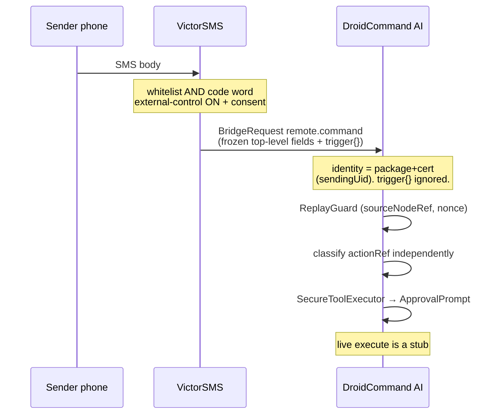
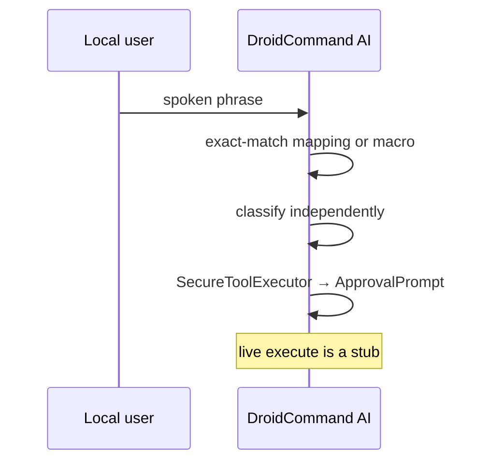

# Remote Control — fleet envelope

Status: **SKELETON**. Spec + JVM data model + Settings UI only.

**Phase boundary (this PR):** frozen fleet envelope codec, three
controller-side transport bindings, replay guard, mapping/macros model,
Settings skeleton, approval-gated tool names. **No live privileged
execution.** No real wipe, power-off, lock, RustDesk, Messenger bind,
AIDL command, or Termux privileged action. Seams return "not implemented"
after `SecureToolExecutor` → `ApprovalPrompt`.

Honesty: **ON DISK / UNVERIFIED**.

DroidCommand AI is the controller. It commands every fleet APK via
direct AI control and via macros, across `EXTERNAL_NODE`,
`BOUND_COMPANION`, and `TERMUX_IPC`.

---

## Phase boundary

| In this PR | Not in this PR |
|---|---|
| Spec, JVM model, unit tests, Settings skeleton | Live privileged execution |
| Frozen envelope + three binding codecs | Live Messenger / AIDL / RUN_COMMAND send |
| Replay cache keyed by `(sourceNodeRef, nonce)` | VictorSMS cert pins (unpinned / fail-open) |
| Advisory `destructive` ignored for gating | Changing Kali / pentest / YOLO pentest gates |
| Macros list/create/edit/bind + dry-run | Live macro run, live scheduler |
| Status-tray consume+publish | Live node status bind |
| Unified local backup (no secrets) | Cloud backup |
| VictorSpoof actionRef registry (isolated) | VictorSpoof package/certs / KnownFleet row |
| `docs/MANUAL.md` + in-app Help | — |

---

## 1. One logical contract

One field set, one op set, one replay rule, one gating rule. Three
encodings (appendices A–C). **Do not invent per-class field names.**

### Ops

| Op | Meaning |
|---|---|
| `capabilities.get` | Advertise protocol **minor 1** (major stays 1). |
| `remote.command` | One action on `targetNodeRef`. |
| `macro.step` | One step of a named macro. |
| `macro.run` | Whole macro (optional `dryRun`). |

Outer framing is still BridgeRequest / BridgeResponse
(`protocol_major` 1, `Message.what` 1 request / 2 response, action
`<pkg>.action.BRIDGE`).

### Top-level fields (frozen)

There is **no nested `auth` object**. Fields are top-level:

| Field | Type | Notes |
|---|---|---|
| `requestId` | string | **The existing BridgeRequest `request_id`.** Reuse it. Do **not** add a second id. Correlates the response. |
| `targetNodeRef` | string | Destination node id (`rootforge-<32hex>`, …) or the literal `controller` for inbound triggers. |
| `actionRef` | string | Op to run on the target (e.g. `scan.run`, or a controller mapping id). |
| `args` | object | Default `{}`. |
| `nonce` | string | 128-bit unique (32 hex). Replay key together with transport `sourceNodeRef`. |
| `timestampMs` | number | `issuedAt` epoch ms. |
| `ttlMs` | number | Default `120000`. Max `300000`. |
| `destructive` | bool | **ADVISORY ONLY.** Never used to authorize. |

`macro.step` also carries:

| Field | Type | Notes |
|---|---|---|
| `macroId` | string | Macro id. |
| `stepIndex` | number | 0-based. |
| `onError` | `"abort"` \| `"continue"` | Default `"abort"`. |

`macro.run` also carries:

| Field | Type | Notes |
|---|---|---|
| `macroId` | string | Macro id. |
| `steps` | array | Ordered step objects (`targetNodeRef`, `actionRef`, `args`, advisory `destructive`). |
| `dryRun` | bool | Validate only. |

### Authorization identity (prominent)

**Source identity for authorization is package + cert (`Message.sendingUid`
on Messenger; Binder caller uid + signature permission on AIDL;
`com.termux.permission.RUN_COMMAND` + allow-list on Termux).**

**Never authorize from a payload field.** A self-reported phone number,
keyword flag, or `destructive:false` cannot grant anything.

VictorSMS may attach an informational sub-object (the only nested
object besides `args` / `steps`):

```json
"trigger": {
  "sourceNumber": "+15555550100",
  "matchedKeyword": true,
  "rawExtras": {}
}
```

`trigger.sourceNumber`, `trigger.matchedKeyword`, and `trigger.rawExtras`
are **telemetry / UX only**. The dispatcher must not read them for
allow/deny. VictorSMS still owns whitelist + code word + external-control
switch (OFF by default) + consent **on its side**. DCA owns
`actionRef` → mapping/macro.

### Example (`remote.command` inbound to the controller)

Outer BridgeRequest (`request_id` is `requestId`):

```json
{
  "protocol_major": 1,
  "request_id": "6f1a9c2e-3b84-4d91-9e0a-11a0c84d0001",
  "target_node_id": "controller",
  "operation": "remote.command",
  "timeout_ms": 120000,
  "parameters": {
    "targetNodeRef": "controller",
    "actionRef": "lock-tablet",
    "args": {},
    "nonce": "aaaaaaaaaaaaaaaaaaaaaaaaaaaaaaaa",
    "timestampMs": 1760920000000,
    "ttlMs": 120000,
    "destructive": false,
    "trigger": {
      "sourceNumber": "+15555550100",
      "matchedKeyword": true,
      "rawExtras": {}
    }
  }
}
```

`requestId` is **not** duplicated inside `parameters`.

### SMS flow



### Voice flow



---

## 2. Replay

Cache keyed by **`(sourceNodeRef, nonce)`**, not a bare nonce.
`sourceNodeRef` comes from the **transport identity** (paired node id /
companion id / Termux node), never from `trigger`.

Retention: **≥ 10 minutes** (≥ max `ttlMs` of 5 minutes).

Reject:

| Condition | Code |
|---|---|
| `now > timestampMs + ttlMs` | `expired` |
| `\|now - timestampMs\| > 120000` | `expired` (clock skew) |
| nonce already seen for that `sourceNodeRef` | `replay_detected` |
| optional: `timestampMs` older than last-accepted for that source | `expired` |

In-memory in this skeleton (lost on process death). Not a MAC.

---

## 3. Destructive flag is advisory

The **receiver independently classifies `actionRef`** (mapping, macro
step, or `RemoteAction` table) and enforces
`SecureToolExecutor` → `ApprovalPrompt` (device-admin / root / Shizuku
+ on-device confirm).

The dispatcher **ignores `destructive` for the gating decision**. It may
use the flag for UX, telemetry, or defense-in-depth copy only.

A forged `destructive: false` on a wipe/power-off/lock `actionRef` must
still be classified destructive and never auto-approved (including YOLO).
Covered by unit test.

WIPE / POWER_OFF / LOCK / custom-destructive / any macro that contains a
destructive step use `remote_wipe` / `remote_power_off` / `remote_lock` /
`remote_destructive`. Those names sit in
`YoloMode.DESTRUCTIVE_REMOTE_NAME_TOKENS`, a **separate** set from
Kali/pentest tokens. YOLO may waive non-destructive `remote_command` /
`remote_screen_control` / `remote_macro` like shell. Kali/pentest
ACTIVE/EXPLOIT gates and `I confirm these targets are authorized` are
**untouched**. Token `lock` is not used (would match clipboard tools).

---

## 4. Mappings, targets, macros

Controller Settings store **command mappings, target devices, and
macros**. They do **not** store VictorSMS whitelist or code word.

```
RemoteCommandMapping  id, displayName, voicePhrase?, smsCommandId?,
                      targetNodeId, action, deliveryMode, destructive
TargetDevice          nodeId, displayName, integrationClass, packageName?
Macro                 id, displayName, steps[], trigger
MacroStep             id, target NodeRef, actionRef, args, destructive,
                      onError abort|continue
```

Triggers: voice phrase, SMS `actionRef`/`smsCommandId`, schedule string,
or manual. Voice match is exact after normalize. Dry-run validates; live
run is a stub. A macro with any independently classified destructive
step requires approval at run.

**VictorSpoof** actionRefs (`spoof.profile.apply`, `spoof.profile.clear`,
`spoof.status`) live in `VictorSpoofRegistry`. They are **isolated from
destructive classification**: even `destructive:true` on the envelope
or a step flag does not turn them into wipe/power-off/lock /
`remote_destructive`. Package, node-id, and certs are [CONTRACT TBD];
VictorSpoof is **not** a `KnownFleet` member in this skeleton.

**Status tray:** `RemoteStatusTray.consume` / `publish` — last snapshot
per `sourceNodeRef`. In-memory. No live bind.

**Unified local backup:** mappings + targets + macros + tray rows to one
JSON file on device. API keys and VictorSMS secrets are **not** included.

**Help:** `docs/MANUAL.md` and in-app `HelpScreen` (`RemoteControlManual`).

Full-screen vs discrete delivery is per mapping (`RUSTDESK_SCREEN` vs
WIPE/POWER_OFF/LOCK/CUSTOM). Live RustDesk is a stub.

---

## 5. Seams vs implemented

| Piece | This slice |
|---|---|
| Frozen envelope codec (top-level fields) | implemented, unit-tested |
| EXTERNAL_NODE BridgeRequest binding | implemented, unit-tested |
| BOUND_COMPANION CommandEnvelope field map | implemented, unit-tested (Kotlin record; live AIDL not bumped) |
| TERMUX_IPC JSON-blob extra | implemented, unit-tested |
| Replay `(sourceNodeRef, nonce)` | implemented, unit-tested |
| Independent destructive classification | implemented, unit-tested |
| Macros + dry-run | implemented, unit-tested |
| Settings UI | Compose skeleton |
| Status tray consume+publish | implemented, unit-tested (in-memory) |
| Unified local backup | implemented, unit-tested |
| VictorSpoof registry | implemented, unit-tested (isolated) |
| Help / `docs/MANUAL.md` | on disk |
| Live execute / bind | **stub** |

---

## 6. [CONTRACT TBD]

1. **VictorSMS signing certs (debug + release).** Catalogue fail-open /
   unpinned. **TODO pin both. Do not invent fingerprints.**
2. Live AIDL parcel bump on `CommandEnvelope` / `ResultEnvelope` copies
   (EDL + companions) to carry `nonce` / `timestampMs` / `ttlMs` /
   `destructive` on the wire. Controller-side mapping is modeled; the
   `.aidl` files are **not** changed in this skeleton (EDL contract is
   copied verbatim until FO + EDL bump together).
3. Termux extra key name on-device (`ai.droidcommand.REMOTE_ENVELOPE_JSON`
   is the controller proposal).
4. SMS body grammar on VictorSMS; who initiates Messenger bind.
5. RustDesk plugin identity.
6. Macro schedule expression language.
7. **VictorSpoof package, node-id, signing certs.** ActionRef registry
   exists; identity is not invented.

---

## Appendix A — EXTERNAL_NODE (JSON / Messenger)

- Action: `<package>.action.BRIDGE` (VictorSMS:
  `com.victorious.sms.action.BRIDGE`).
- `Message.what` 1 = request (Bundle key `request`), 2 = response
  (`response`).
- Body: existing `BridgeRequest` / `BridgeResponse`, `protocol_major` 1.
- `requestId` **is** `BridgeRequest.request_id`. Not repeated in
  `parameters`.
- Frozen fields live at the **top level of `parameters`** (camelCase).
- Identity: `Message.sendingUid` + observed package/cert. Never
  `Binder.getCallingUid()`.
- VictorSMS package `com.victorious.sms` (debug==release). Node-id
  `^victorsms-[0-9a-f]{32}$`. Certs TBD (fail-open).

---

## Appendix B — BOUND_COMPANION (AIDL)

Same logical fields. Encoding: existing `CommandEnvelope` /
`ResultEnvelope`, mapped 1:1:

| Frozen field | CommandEnvelope |
|---|---|
| `requestId` | `requestId` |
| `actionRef` | `command` |
| `args` | `argsJson` |
| `nonce` | parcel field `nonce` (modeled; AIDL bump later) |
| `timestampMs` | parcel field `timestampMs` |
| `ttlMs` | parcel field `ttlMs` |
| `destructive` | parcel field `destructive` (advisory) |
| `targetNodeRef` | companion node id (hub-side; not a second name) |

Identity: Binder caller uid + signature permission + DependencyGuard.
`dryRun` on today's EDL envelope stays EDL-specific; fleet `macro.run`
uses frozen `dryRun`.

This slice ships a Kotlin mapper (`BoundCompanionRemoteBinding`). It does
**not** rewrite `core-companion` AIDL (copied from EDL).

---

## Appendix C — TERMUX_IPC (`RUN_COMMAND` JSON blob)

Same logical fields. Encoding: **one JSON-blob extra** on the existing
`com.termux.RUN_COMMAND` intent. Extra key (controller proposal):
`ai.droidcommand.REMOTE_ENVELOPE_JSON`. The blob is the frozen camelCase
object **including** `requestId` (there is no BridgeRequest wrapper).

Identity: `com.termux.permission.RUN_COMMAND` + VictorSuite
allow-external-apps allow-list. Not a new bound service.

Live dispatch is a stub (`TermuxIpcRemoteBinding` encodes/decodes only).
